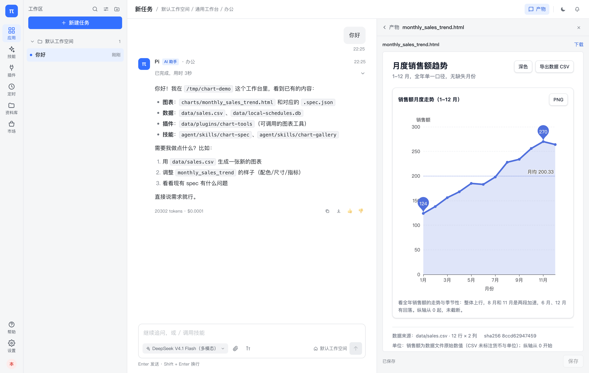

# 数据绘图（chart）

把工作区的数据画成**可交付的 ECharts 6 HTML**：交互、能导出 PNG/CSV、页脚写清数据出处。
图里的每个数字都由工具从数据文件绑定，模型不抄数字。

由三样东西组成：**一个内置应用 + 两个技能 + 一个工具插件**。

```
apps/chart/                 应用说明与安装（应用本身在内置目录里）
├── README.md
└── install.sh              装技能 + 打插件包；内置应用重启即出现

template/skills/chart-spec/       交付契约：数据纪律、选型、视觉规范、不说谎检查表
template/skills/chart-gallery/    选型表 + 模板索引（option 在 chart_tools 的 templates/）
plugins/chart-tools/              chart-tools：4 个工具 + 37 个模板，唯一的产图入口
web/public/vendor/echarts.min.js  产物 HTML 引用的图表引擎（6.1.0）
```

技能和插件都放在各自**唯一的**规范位置，不在 `apps/` 下再存一份——两份会漂移。
`install.sh` 负责把它们搬到部署真正会读的目录。

## 为什么是 HTML 产物，而不是在聊天里内联一张图

- 产物面板用 iframe 打开文件，**隔离**：`sandbox="allow-scripts allow-downloads"`，
  没有 `allow-same-origin`——脚本能跑（不然图是白的），但拿不到父页面 DOM、cookie、
  localStorage，也读不到同源接口；
- HTML 是**可下载、可发邮件、可归档**的交付物，PNG/CSV 按钮就在页面里；
- 图表要 hover、缩放、切深浅色，静态图片给不了。

代价与边界写在下面「限制」。

## 四个模式

| 模式 | 用途 | 加载技能 |
|---|---|---|
| **单图** | 一句话/一份表 → 一张图 + 一句结论 | chart-spec + chart-gallery |
| **仪表盘** | 一个数据集 3–6 张图，一屏看清趋势/构成/异常 | chart-spec + chart-gallery |
| **数据解读** | 先看数据再给图：三条发现、一个反例、不能下的结论 | chart-spec |
| **图表改版** | 截图/旧图 → 换类型或改样式，并说明原图哪里误导 | chart-spec + chart-gallery |

## 四个工具

| 工具 | 干什么 | 为什么不能交给模型 |
|---|---|---|
| `chart_templates` | 37 种图的完整 spec（都渲染过）；可按族筛选、可校验数据列名 | 手写 option 容易漏 `dataset`/encode 写错列，图就空白 |
| `chart_data_profile` | 列类型、缺失、基数、数值范围；给选型建议 + 可改的 spec 骨架 | 整表进上下文费用高；结构判断要一致 |
| `chart_check` | 校验 spec：schema、绑定列、encode 引用、custom/3D、手写数字、饼图分类、双轴 | 模型自检不可靠，且它不知道自己错了 |
| `chart_render_html` | 绑定真实数据 → 生成 HTML，写页脚溯源，校验 480KB 上限 | 数据绑定要确定；手写 HTML 等于执行任意脚本 |

## spec 的形状

```jsonc
{
  "schema": "pi.chart/1",
  "page": { "title": "…", "subtitle": "口径", "columns": 1, "theme": "auto" },
  "bind": { "path": "data/sales.csv", "sheet": null, "columns": ["month", "sales"] },
  "charts": [
    {
      "title": "写结论，不是字段名",
      "option": {
        "dataset": {},                       // 留空，工具填
        "xAxis": { "type": "category", "name": "月份" },
        "yAxis": { "type": "value", "name": "销售额（万元）" },
        "series": [{ "type": "line", "encode": { "x": "month", "y": "sales" } }]
      },
      "note": "怎么读 / 哪里不能比"
    }
  ],
  "notes": { "unit": "万元", "source": "财务月报 2025", "caveat": "12 月为预估" }
}
```

**写 `dataset.source` 会直接报错**——数据只能从 `bind` 来。手写 `series.data` 数字会被警告。
`bind.aggregate`（`{"by": "region", "op": "sum"}`）用于"按类目汇总"，它一定出现在警告里，
提醒图注交代口径。

## 安装

应用是**内置**的（`apps.py` 里的 `CHART`），重启服务即出现，不需要导入 JSON，也不需要点插件启用——
它声明了 `plugins=("chart-tools",)`，宿主会自动加载。

技能与插件：

```bash
./apps/chart/install.sh --team        # 部署：技能进模板 + 插件进 <data-root>/plugins
./apps/chart/install.sh --project     # <repo>/.pi/skills（单机 / 仓库当工作区）
./apps/chart/install.sh --template    # <repo>/template/skills（随仓库分发）
./apps/chart/install.sh               # ~/.pi/agent/skills（用户级）
```

`--team` 的 data root 默认 `~/.pi/team`，可用 `PI_DATA_ROOT` 覆盖。

前端依赖 `web/public/vendor/echarts.min.js`（Apache ECharts 6.1.0，见同目录 README）。
改过 web 之后要重新 `npm run build`，否则产物面板可能仍是旧版。



## 已验证（2026-11-12）

| 项 | 结果 |
|---|---|
| 沙箱隔离 | iframe 内脚本可跑（2 张图渲染成功），`window.parent.document` 抛 `SecurityError` |
| 产物面板 | 生成 `charts/monthly_sales_trend.html` → 产物列表点开 → 图可交互、PNG/CSV 可下载 |
| 真实模型跑通 | 一轮对话里依次调用 `chart_data_profile` → `chart_check` → `chart_render_html` → `present` |
| 模板链路 | 换一轮「用模板画面积图」：`chart_templates` 取 `line-area` → 改 bind/标题 → `chart_check` 0 error → 产物面板可交互 |
| 数据绑定 | 页脚 `data/sales.csv · 12 行 × 2 列 · sha256 8ccd…`；`__data` 与 CSV 逐行一致 |
| 校验器 | 15 个单测（含沙箱策略、vendor 文件的不变量）：手写数据、custom/3D、越界列、6000 行不聚合、路径逃逸都会拦下 |
| 模板库 | **37 个模板全部渲染过**（浏览器逐张检查画布有彩色像素、无 console error）；单测对每个模板跑 `check_spec` + `bind_data` + `render_html` |
| 技能加载 | `discover_skills_with_diagnostics` 两个技能均 ok；`pikit check` 0 警告 |

## 限制（这些是设计选择，不是待办）

- **不做 3D/GL**：需要 `echarts-gl`，内置包只有核心，渲染是空白 → 校验器直接报错；
- **不做 custom 系列**：`renderItem` 是函数，JSON 存不下 → 报错并建议等价二维表达；
- **不做地图**：`registerMap` 需要在 JS 里注册 GeoJSON，中国地图另有审图号合规问题；
- **页面 ≤480KB**：产物面板在 512KB 处截断预览，超了图就不渲染。超了先聚合/减列，
  不要靠 `bind.limit` 硬截（那会让图说谎）；
- **导出 PNG 在浏览器里做**：不引入 Node/Chromium 服务端渲染。要给 Word/PPT 嵌图，
  目前是"打开产物 → 点 PNG → 插入"，不是自动的；
- **HTML 由固定模板生成**：模型只能给 option（纯 JSON）。想写自定义脚本就去改模板，
  不要让模型直接写 HTML。

## 安全模型

- iframe：`allow-scripts allow-downloads`，**不含** `allow-same-origin` → 不透明源，
  父页面不可达。这一条是硬约束：两个一起给，srcdoc 就继承了工作台的源；
- 产物 HTML 里有 CSP 的 `connect-src 'none'`、`img-src data: blob:`、`object-src 'none'`，
  挡掉最常见的注水/外传；不设 `script-src` 是为了让 `/vendor/echarts.min.js` 能加载；
- spec 里的 JSON 在写入 HTML 前做了 `</` 转义，不会提前闭合 `<script>`；
- 模型提供的是数据与样式，不是代码：没有 `renderItem`、没有内联 `onclick`、没有自定义脚本。

## 已知取舍

- **不内联 ECharts**：内联 1.1MB 会让每个产物超过预览上限；改成静态资源后，文件只有 10–15KB；
- **`chart_check` 会读一遍数据**（只为判断饼图分类数），大表会慢一点；必要时可以先 profile 再 hand-write；
- **中文字体**：产物用系统字体，Linux 服务器只影响服务端截图（当前没有服务端截图）。
