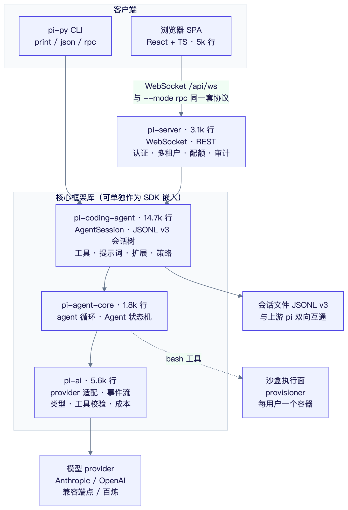
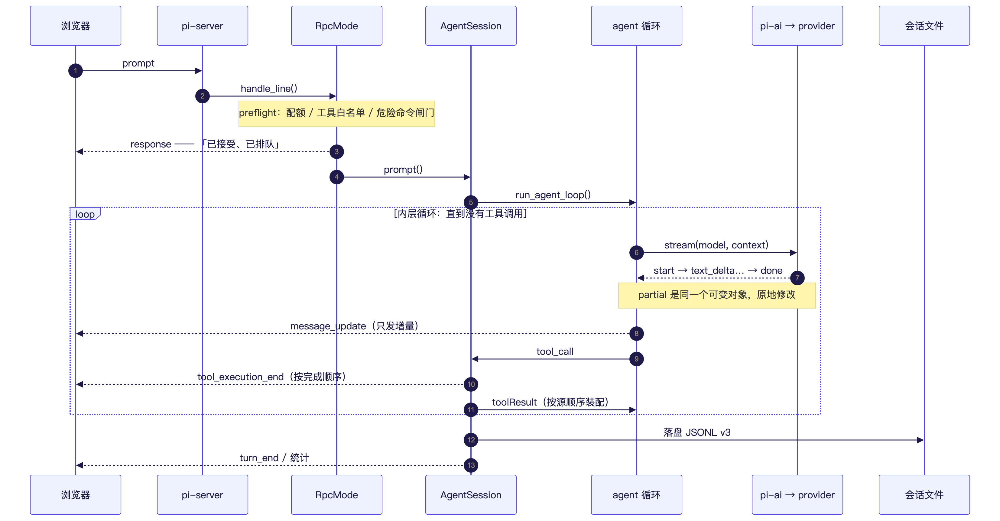
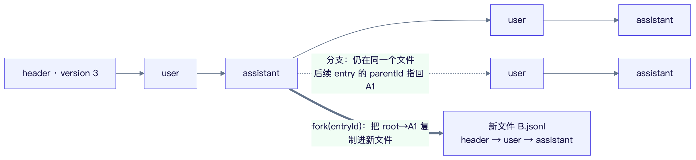
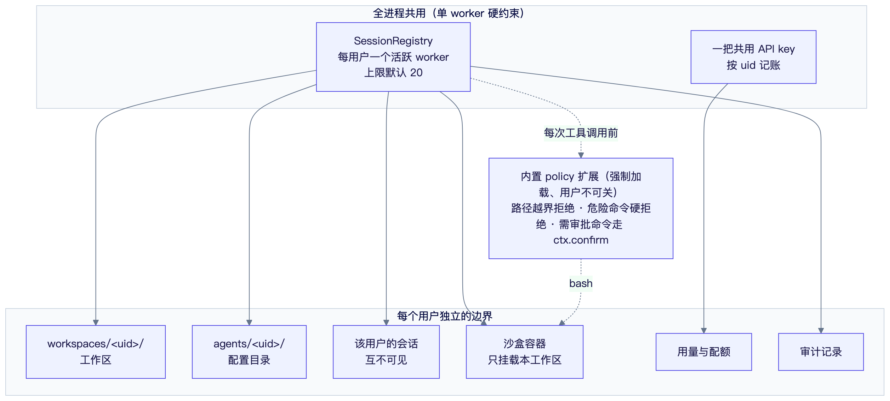

# python-pi 技术分享

> 面向组内工程师，30 分钟。目标：讲清**它是什么、怎么分层、四个关键决策为什么这么选**，
> 以及哪些坑我们已经替你们踩过了。读完你应该能画出示意图，并知道从哪下手改。

---

## 0. 先给结论

`pi` 是一个 TypeScript 写的**极简终端 coding agent harness**（11 个 npm 包，约 18 万行）。
本仓库是它的 **Python 移植版**，做了两件上游没有的事：

1. 提供一套**可嵌入的 Python agent 框架**（`pi-ai` / `pi-agent-core` / `pi-coding-agent` 三层）；
2. 在原协议之上加了**浏览器 UI + 团队多租户部署**（`pi-server` + `web/`），
   可以内网多人共用、每人一个工作区和沙盒容器。

**与上游互通**：会话文件是同一个 v3 JSONL 格式，Python 版能读 pi 写的会话，pi 也能读它写的。

| | 数字 |
|---|---|
| Python 核心 | 25.2k 行（`pi-ai` 5.6k / `pi-agent-core` 1.8k / `pi-coding-agent` 14.7k / `pi-server` 3.1k） |
| 前端 | 5.0k 行（React + TS，23 个文件） |
| 测试 | 31 个文件、588 个测试函数、14.8k 行，**全部离线、不需要 API key** |
| 上游对照 | 约 18 万行 TS，本移植约 3 万行 —— 差的是 TUI（18k）、harness 持久化运行时（12k）、chord、CBOR 栈、telemetry、evals |

---

## 1. 上游调研：三个决定移植范围的结构性发现

移植最大的风险不是"写不出来"，而是**把不该搬的东西搬过来**。逐层读完上游源码后，有三条结论
直接决定了边界（完整调研见 [`docs/research/`](research/)）：

1. **裸 agent 循环是自包含的。** `packages/agent/src/{types,agent-loop,agent,stream-fn}.ts`
   约 1.6k 行，对 `harness/` **零 import**。而 `harness/`（约 12k 行）是附加的持久化运行时
   （会话树 + 操作状态机 + 意图结算），**不是最小移植的必需品**。
2. **`chord` 的完整内核只在实验代码里用。** 除了 `coding-agent/src/experimental/**`，
   没有任何非实验代码 import 它。
3. **CBOR 远程栈与 `--mode rpc` 是两套协议。** 前者是实验性 devDependency，后者才是稳定的
   集成方式 —— 所以我们只做后者。

**结论**：只搬 `pi-ai` + `pi-agent-core` + `pi-coding-agent` 核心，做一个干净的 Python 库。

---

## 2. 架构分层




四层，依赖严格单向：

- **`pi-ai`** —— provider 抽象。消息/内容块/Usage/Model 类型与 JSON 互转、**12 种流式事件**的
  `EventStream`、provider 注册表、Anthropic 与 OpenAI 兼容适配器、工具参数校验、成本计算。
  只依赖 `httpx`。
- **`pi-agent-core`** —— agent 循环（steering / follow-up / 工具批 / 中止语义）+ `Agent` 状态机。
  1.8k 行，可以单独拿去驱自己的工具。
- **`pi-coding-agent`** —— 编码助手的全部内容：JSONL v3 会话树、7 个内置工具
  （read/write/edit/bash/grep/find/ls）、系统提示词组装、skills、settings、`AgentSession` 编排、
  print/json/rpc 三种模式、扩展协议。
- **`pi-server`** —— 上游没有的一层。把同一套命令协议架在 WebSocket 上，加认证、多租户、
  配额、审计，并托管 React SPA。

**核心三层加起来只引入两个第三方包**：`pi-ai` 用 `httpx`（传输）与 `pyyaml`（frontmatter），
`pi-agent-core` 不加任何新依赖，`pi-coding-agent` 复用 `pyyaml`。`pi-server` 才多出第三个：
`fastapi` + `uvicorn[standard]`（`[standard]` 是必需的，裸 uvicorn 根本不接受 WS 连接）。
前端也只要 4 个运行时依赖：react、react-dom、marked、dompurify。

上游用到的 `typebox`、`diff`、`ignore`、`partial-json`、`chalk`、`proper-lockfile`
在 Python 侧分别用内联实现、`difflib`、自写 ignore 匹配、`json` 容错解析和标准库替代。

---

## 3. 一次 prompt 的完整链路



几个容易看错的地方：

- **`prompt` 在 preflight 就回响应**，语义是"已接受/已排队"，不是"已完成"。配额不足在这一步
  就被拒，用户不用等模型跑完才发现（`RpcMode.handle_line` 在 preflight 阶段回响应）。
- **`partial` 是所有流式事件共享的同一个可变对象，原地修改**，不是每事件的快照。
  消费方保存引用会拿到被改过的历史。
- **并行工具执行**：`tool_execution_end` 按**完成顺序**发，但 toolResult 消息按**源顺序**装配。
- **`message_update` 只发增量**，但保留累计 `usage`。

---

## 4. 四个关键决策

### 4.1 会话文件互通，而不是"另立格式"



会话是 pi 的格式：`<agent_dir>/sessions/--<cwd>--/<ts>_<id>.jsonl`，JSONL、version 3，
靠 `id`/`parentId` 构成**树**：

- **分支是原地发生的**：同一文件里继续 append，新 entry 的 `parentId` 指回分叉点，不新建文件；
- **`fork()` 才复制文件**：把 root→entry 的路径复制进新文件；
- 字段名逐个对齐（`stopReason` / `toolCallId` / `cacheRead` …），`undefined` 省略语义也一致；
- 能读 v1/v2 并在写回时迁移到 v3。

**为什么值得**：会话是这类工具最贵的数据资产。格式统一意味着两边的会话可以互相打开，
也意味着我们不用维护第二套 schema。

### 4.2 浏览器 UI 复用 RPC 协议，不造第二套 API

`--mode rpc` 是 stdin/stdout 上的严格 LF JSONL 协议，**30 个命令**（其中 3 个明确不支持并会
返回带原因的失败响应，而不是静默挂起）。浏览器说的就是这套：

```
浏览器 (React SPA)
   │  WebSocket /api/ws —— 与 --mode rpc 完全相同的命令与事件
   ▼
pi_server.app.AgentServer
   │  emit(payload) 注入
   ▼
RpcMode（stdio 传输被换成 emit 回调 + handle_line，其余原样复用）
```

所以**任何为 pi RPC 写的客户端，改个地址就能连浏览器这层**；反过来，这里验证过的协议行为
对 stdio 同样成立。三个具体教训：

- **帧层不能用 `str.splitlines()` 或 Node 的 `readline`** —— 它们会把字符串内部的
  U+2028/U+2029 当换行，把一条记录撕成两半。实现是原始字节读取 + 显式 UTF-8 解码
  （`modes/jsonl.py`）。
- **出站帧必须用与 stdio 相同的序列化器**（`serialize_json_line`，带 `default=str`）。
  换成严格编码的 `send_json`，遇到非纯 JSON 载荷会抛异常；而同步的 `emit` 回调没法把异常
  传回去，发送任务会静默死掉 —— 表现为"流到一半卡住"。
- **需要用户作答的对话框只发给一个标签页**。同一个 `confirm` 在三个标签页同时弹出、再等最先
  作答的那个，比只问一次更糟；id 唯一，所以过期应答会被忽略。

### 4.3 语义保真优先于"Python 化"

移植时**刻意没有**按 Python 的习惯改写这些行为，因为它们是可观察契约的一部分，
也是回归测试的重点（完整 16 条见 [`docs/ARCHITECTURE.md`](ARCHITECTURE.md) §5）：

| 行为 | 容易搞错的地方 |
|---|---|
| `partial` 共享可变对象 | 不能每事件深拷贝一份 |
| `EventStream` 是 push 队列 | 完成事件本身仍要投递给迭代方；`result()` 在首个 `done`/`error` 即 resolve，不等 `end()` |
| 两个相反的错误契约 | `stream()` 绝不因 setup 失败抛异常（编码成 `error` 事件）；`stream_simple()` **可以同步抛** |
| `stop_reason == "length"` | 整批工具调用**都不执行**，全部报错让模型重发 |
| `terminate` | 只有批次内**每一个**结果都是 `terminate` 才终止循环 |
| 两处 hook 的异常语义不同 | `before_tool_call` 抛异常 → 变成 error tool result；`after_tool_call` 抛异常 → **丢弃结果** |
| `AbortSignal` | 是**被观察的标志**，不是 `CancelledError`；中止时合成 "Operation aborted" 的工具结果并正常发事件 |
| `clampThinkingLevel` | 方向是"就高不就低"：先往更强找，再往更弱找 |
| `thinkingLevelMap` | 必须区分**键不存在**（provider 默认）与**显式 null**（不支持），用 `in` 判断而不是真值判断 |
| 成本分档 | 基于 `input + cacheRead + cacheWrite`，严格 `>` 命中最高档；1h 缓存写入按 2× input 计价 |
| 时间戳单位 | 消息是**毫秒整数**，会话 entry 是 **ISO 字符串** |
| 会话文件创建时机 | **第一条 assistant 消息落盘之前不创建文件** |

一句话：**能逐字对齐的地方就不要"改进"**。这类代码的可维护性来自与上游的可对照性。

### 4.4 团队模式：隔离靠什么，边界在哪



`--auth-mode team` 打开多租户。每个用户独立的：工作区、配置目录、会话、沙盒容器、用量、审计。
全进程共用的：会话注册表、一把 API key（内部按 uid 记账）。

治理层有几个**必须这么做**的地方：

- **团队模式下拒绝加载用户扩展**（`agents/<uid>/extensions/` 与项目 `.pi/extensions/`）。
  per-uid 的扩展目录 = 给每个同事一个**以服务进程权限运行的 RCE 入口**。
  内置 policy 扩展则**强制加载、用户不可关** —— 所以要在 `BootstrapOptions` 上区分
  「内置扩展」和「用户扩展」两类来源。
- **子进程环境按变量名白名单构造**，剔除 `*_KEY` / `*_TOKEN` / `*_SECRET` / `*_PASSWORD` / `AWS_*`。
  共用 key 也不能走命令行参数 —— `ps aux` 对同机所有账号可见。
- **治理层建在扩展 seam 上，`tools/*.py` 一行未改**。代价是策略扩展必须先加载。
- **`bootstrap` 的 `SystemExit` 必须收敛成 `BootstrapError`**：它继承自 `BaseException` 而不是
  `Exception`，在服务端会直接击穿请求处理。

**必须说清楚的一句话：这不是沙盒。** 白名单 + 审批防的是**误操作**，防不住**恶意**。
真实的边界是二期的容器：`PI_SANDBOX_BACKEND=provisioner` 时，agent 的每条命令都在一个
只挂载该用户工作区的容器里执行。另外两条边界要记住：

- **沙盒只覆盖命令执行**，`read`/`write`/`edit` 仍由服务进程直接读写工作区（受路径规则限制）；
- **单进程是硬约束**：会话状态在进程内存里，必须 `--workers 1`。横向扩展要先换掉注册表
  （Redis 广播 + 无状态网关，届时一并换 PG）。

---

## 5. 工程实践：不靠 API key 也能全绿

这是我认为这个仓库最值得借鉴的部分。**588 个测试全部离线运行**，三根支柱：

1. **上游对齐** —— 关键行为逐字对齐而不是"大致相同"，所以断言可以直接抄上游测试；
2. **黄金用例** —— agent 循环的 12 事件序列取自上游断言；会话存储有手工构造的 v3 JSONL
   黄金文件，验证读取、上下文重建与再序列化（字节保真度曾用 node 的
   `JSON.stringify(JSON.parse(line))` 交叉验证）；
3. **真实线格式** —— provider 适配器用 `httpx.MockTransport` 喂入固定 SSE 字节，
   断言到请求体字段级。

再往上一层是 **CLI 端到端**（`tests/test_cli_end_to_end.py`）：起一个本地假 OpenAI 兼容服务，
以**子进程**运行真实 `pi-py`，完整走通"加载配置 → 解析模型 → 读凭据 → SSE 流式响应 →
装配流式工具调用 → 执行真实工具 → 落盘 v3 会话"；同一文件里还有一组通过真实管道驱动
`--mode rpc` 的测试（命令/响应相关性、事件流、坏行恢复、EOF 退出）。

团队模式另有 `tests/test_multi_user.py`：并发互不干扰、每人只见自己的工作区与会话、
用量与审计按 uid 归属、满员时**拒绝而不是降级**、一个人的配额用尽不影响他人。
线上自检用 `deploy/smoke.py`（20 项，覆盖"是否真的在拦截"），压测用
`deploy/loadtest.py --verify-isolation`。

---

## 6. 现状、已知取舍、下一步

**已完成**：P0–P5 全部落地（核心库 → provider/工具/会话 → 编排与 print/json 模式 →
RPC 30 命令与会话替换 → Python 原生扩展协议 → 浏览器 UI），以及团队多租户
M0–M6 和二期沙盒执行面。

**明确的取舍**（不是遗漏，是选择）：

- `grep` / `find` 是纯 Python 实现（不依赖 `ripgrep` / `fd`），`.gitignore` 支持为简化版，
  因此语义是"接近"而非逐字节相同；
- `edit` 不做上游模糊匹配兜底之外的全部启发式；
- 不做跨语言扩展兼容：`ExtensionAPI` 的 renderer 返回组件、同进程 `AbortSignal`、
  参数原地修改等语义**无法跨 RPC 边界存活**，Python 侧另设计了原生插件协议（[`docs/EXTENSIONS.md`](EXTENSIONS.md)）；
- 工具越界只由策略扩展拦；`cd /elsewhere && rm -rf *` 这类"先改目录再操作"无法静态识别。

**最大的验证缺口要坦白说**：开发环境没有任何 provider 的真实 API key，
所以**没有对真实服务做过在线验证**。首次接入时请先用一个小 prompt 验证适配器。
另外浏览器端的 team 登录流程由 jsdom + 假 transport 覆盖，没有真实浏览器的端到端测试。

**下一步**：多 slot（同一用户并发多会话，需要按 session 寻址与路径校验）、
横向扩展（Redis + PG）、把文件工具也迁进沙盒容器、Qwen 系列的 `enable_thinking` 兼容位。

---

## 7. 上手（5 分钟）

```bash
git clone https://github.com/johnson7788/python-pi && cd python-pi
uv sync

# 完全离线、不需要 API key：真实工具 + 真实会话落盘，用确定性的 faux provider 替代 LLM
uv run python examples/offline_agent.py

# 跑测试
uv run pytest -q
```

想看浏览器 UI：

```bash
cp .env.example .env && $EDITOR .env    # 填 PI_API_KEY
./start.sh                              # 然后打开 http://127.0.0.1:8787
```

想内网多人用：

```bash
python3 deploy/deploy_docker.py up --api-key sk-…
```

**读代码的建议顺序**：`pi_agent/loop.py`（循环本体，847 行）→
`pi_coding_agent/agent_session.py`（编排层，1.4k 行，所有能力的交汇处）→
`pi_server/app.py`（1.4k 行，`SessionRegistry` / `SessionWorker`，团队模式的全部复杂度在这里）。
扩展怎么写看 [`docs/EXTENSIONS.md`](EXTENSIONS.md)：一个普通 Python 模块暴露 `setup(pi)` 即可。

---

## 8. 讨论题（留给 Q&A）

1. **会话格式对齐上游**带来的长期收益（生态互通）和成本（被别人的 schema 绑住），换你选哪个？
2. 团队模式下 `read`/`write`/`edit` **没走沙盒**，只在服务进程里做路径校验 ——
   要做到真隔离，是迁进容器还是改用协议？  
3. 单 worker 是硬约束。如果明天要支持 200 人，你会先改注册表还是先拆服务？
4. 离线测试覆盖了协议与循环，但**真实 provider 没验证过**。上线前的最小验证集应该是什么？

---

## 附：分享节奏建议（30 分钟）

| 时长 | 章节 | 讲法 |
|---:|---|---|
| 2 min | §0 结论 | 先给数字和"上游没有的两件事" |
| 5 min | §1 + §2 | 用图 01 过一遍分层，强调"只有两个运行依赖" |
| 6 min | §3 | 用图 02 走一次请求，重点讲 preflight 与 `partial` |
| 12 min | §4 | 四个决策各 3 分钟 —— 这是全场重点 |
| 3 min | §5 | 测试策略，重点"没有 key 也能全绿" |
| 2 min | §6 + §7 | 坦白限制，给上手命令 |

相关文档：[`ARCHITECTURE.md`](ARCHITECTURE.md)（设计与易错清单）、
[`DEVIATIONS.md`](DEVIATIONS.md)（与上游的逐条偏差）、
[`EXTENSIONS.md`](EXTENSIONS.md)、[`DEPLOY.md`](DEPLOY.md)、
[`plans/2026-09-14-team-saas-design.md`](plans/2026-09-14-team-saas-design.md)（团队版设计与落地复盘）。

> **图怎么改**：四张图是 Mermaid，源码在 `docs/diagrams/*.mmd`（连同 `mermaid.config.json`）。
> 改完重新渲染：
> `cd docs/diagrams && mmdc -i 01-layers.mmd -o 01-layers.png -c mermaid.config.json -b white`
> 放进仓库的是 PNG 而不是内联 Mermaid，因为分享材料经常被导出成 PDF 或粘进 PPT，那种场景下
> 内联 Mermaid 不会渲染。
