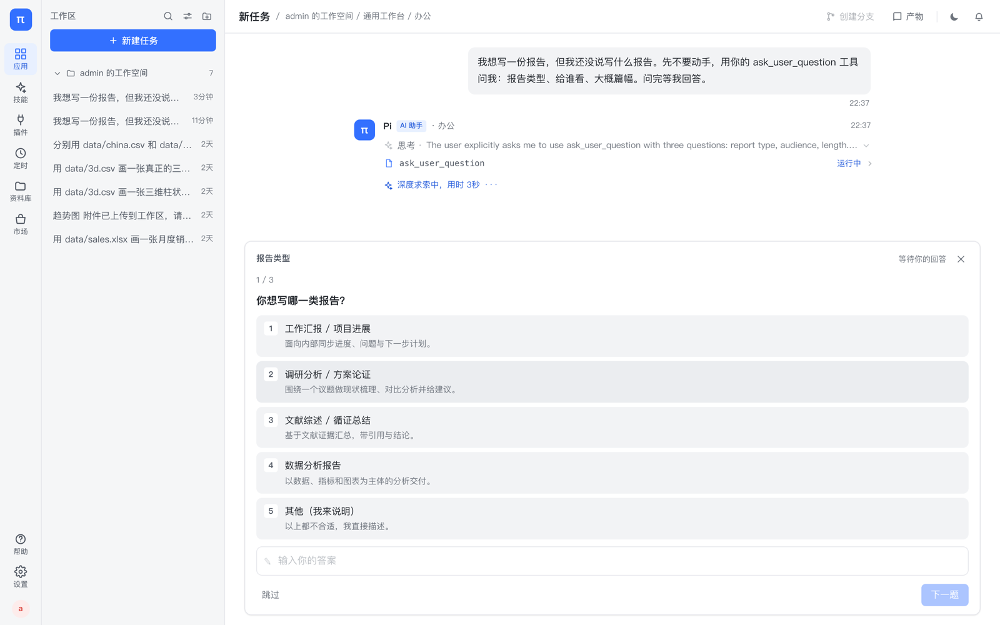
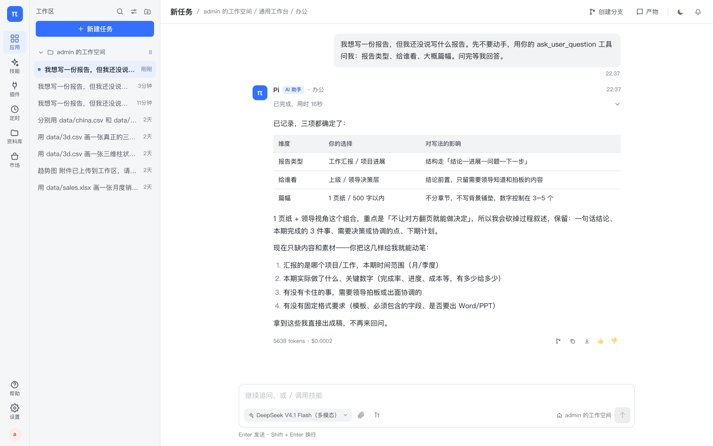
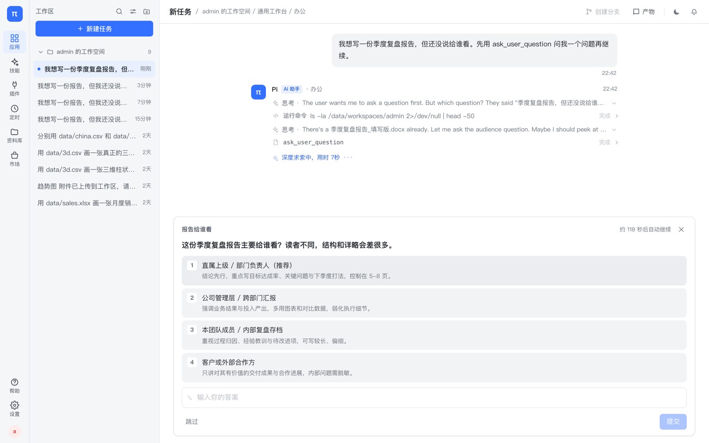

# 提问：让模型停下来问人

模型在目标不明确时需要问一句，而不是猜。这份文档描述 pi-agent 的
`ask_user_question` 通道：它解决什么问题、协议长什么样、以及哪些不变量不能让。

实现分三处：

| 层 | 文件 | 职责 |
|---|---|---|
| 会话 | [`user_questions.py`](../packages/pi-coding-agent/src/pi_coding_agent/user_questions.py) | 词汇表、校验、投影、等待与超时 |
| 工具 | [`tools/ask_user.py`](../packages/pi-coding-agent/src/pi_coding_agent/tools/ask_user.py) | 模型看到的 schema、结果与错误码 |
| 界面 | [`QuestionCard.tsx`](../web/src/components/QuestionCard.tsx) | 接管输入区的卡片、分页、草稿 |

---

## 1. 一次提问的生命周期

```
assistant toolCall(ask_user_question)
        │
        ├── 有人连着浏览器 ──► user_question_request ──► 卡片
        │                                             │
        │                        answer_question ◄────┘
        │                                 │
        │                        toolResult {answers:[…]}
        │
        └── 超时（默认 120s，可 -1 表示必须回答）
                                 │
                        toolResult {pending:true, callId}
                                 │
        之后用户作答 ──► 一条 user-question-reply 用户消息 ──► 新的一轮
```

两条路径都结束于「模型拿到信息」，区别只在：`answers` 是本次调用拿到的，
`pending` 是告诉模型「先干别的，答案会以用户消息的形式补过来」。

## 2. 词汇表

```jsonc
// 请求
{"questions": [{
  "id": "kind",                        // 必填，回答里回传
  "question": "这份报告是哪一类？",      // 必填
  "header": "报告类型",                 // 可选，卡片标题
  "detail": "…",                       // 可选，长文本（计划、diff 摘要）
  "options": [{"label": "工作进度汇报", "description": "结论先行…"}],
  "multi_select": false,
  "intent": {"kind": "approval", "approve": "Allow", "reject": "Deny"}
}]}

// 回答：每个问题恰好一条
{"answers": [{"id": "kind", "selected": ["工作进度汇报"]}]}
{"answers": [{"id": "kind", "selected": [], "custom": "我自己写"}]}
{"answers": [{"id": "kind", "selected": []}]}          // 跳过
```

几条约定，都是刻意的：

* **选项的 `label` 就是答案值。** 不做序号映射，回答在会话文件、导出和模型上下文里都是人话。
* **推荐项排第一，并在 label 末尾加 `(Recommended)`**，不额外加字段。
* **跳过 = 空的 `selected` 且没有 `custom`。** 工具描述里明确告诉模型：跳过不是许可，
  不要重复问同一个问题。
* **`intent` 只改呈现。** `plan-review` / `approval` 让 UI 换一种画法；不认识的 UI
  退化成普通选项列表，回答编码完全一样。

## 3. 状态是推导出来的

`fold_questions()` 只读会话消息，不另存一份状态：

* `toolCall` 出现 → `open`
* tool result 是 `{"pending": true}` → `continued`（仍可回答）
* tool result 是 `{"answers": …}` → `settled`
* 迟到回答的 `user-question-reply` 消息 → `settled`

因此刷新页面、换标签页、重启服务端之后，`get_state.pendingQuestions` 仍然能把
还能回答的问题原样还给前端。没有第二份真相，也就没有「弹窗状态和会话对不上」这种 bug。

## 4. 超时的所有权

超时不是「到点就丢」：

* 默认 120 秒；模型可以传 `timeout`（秒），`-1` 表示必须回答。
* `-1` 仍有 15 分钟的安全上限——工具不能把 worker 永久占住，但超时后问题**仍然可回答**。
* 客户端收到问题后 `claim_question`，由它自己的时钟倒计时；服务端只在**没人认领**时
  才跑自己的计时器。用户认真读题不会被超时惩罚，标签页悄悄关掉也不会让回合永远挂着。
* 超时/关闭返回的是 `pending`，不是拒绝、不是同意、也不是空回答。

## 5. 协议

服务端 → 客户端：

| 事件 | 何时 |
|---|---|
| `user_question_request` | 模型发起一次提问（含 `callId`、`questions`、`timeoutMs`） |
| `user_question_settled` | 回答、超时或取消；`outcome` 是 `answers` / `pending` / `cancelled` |

客户端 → 服务端：

| 命令 | 作用 |
|---|---|
| `claim_question` | 认领倒计时，返回剩余毫秒 |
| `answer_question` | 提交一批回答（`cancelled: true` 表示关闭卡片） |
| `question_timeout` | 客户端倒计时结束 |

`get_state` 额外返回 `pendingQuestions`，供重连时重放。

## 6. 不允许发生的事

* **子 agent 不能问人。** 子会话拿到的是 `delegated` broker：工具根本不注册，
  真被调用也会返回 `DELEGATED_CALLER`，让子 agent 把未决问题写进最终结果。
* **没有界面时不阻塞。** 没有浏览器标签页、定时任务、headless 运行时都返回
  `NO_PROVIDER`，并告诉模型「说明假设继续」。
* **不伪造工具结果。** 迟到回答永远是新的一条用户消息，不回头改写已经结束的调用。
* **不让一个问题拖死整个 worker。** 所有等待都有上限。

## 7. 错误码

| code | 含义 | 模型应该 |
|---|---|---|
| `EMPTY_QUESTIONS` | 没给问题 | 修参数 |
| `BAD_QUESTIONS` | 缺 id/question、选项重复、超过 4 问 8 选项 | 修参数 |
| `BAD_TIMEOUT` | 超时不是 -1 或正数 | 修参数 |
| `BAD_ANSWER` | 回答没覆盖每个问题、选了没提供的选项、单选选了多个 | 重来 |
| `BAD_INTENT` | 意图里点名的 label 不在选项里 | 修参数 |
| `NO_PROVIDER` | 没人在线 | 别再问，说明假设继续 |
| `DELEGATED_CALLER` | 子 agent 想直接问人 | 把问题写进最终结果 |
| `ASK_ABORTED` | 回合被取消、或阻塞式提问到达安全上限 | 继续或说明 |
| `UNKNOWN_QUESTION` | 回答指向一个已经不可回答的问题 | 不要再答 |

## 8. 界面

* **卡片接管输入区**，不是浮层：模型此刻是停住的，藏在角落等于让回合静默卡死。
* 多问一屏：`1 / N` 翻页；单选点完自动下一题，多选和自由输入需要显式「下一题」。
* 每题都有「跳过」；「跳过」只跳过这一题，不会把整批作废。
* 未提交的输入按会话存在 localStorage；离开页面再回来不会丢。
* 超时后卡片变成「仍可回答」，输入区上方出现一条提醒，随时可以补答。

## 9. 线上验收（实拍）

2026-11-19 部署到测试环境之后，用真实 Chromium 走了一遍完整链路：登录 → 首页提一个目标不明确的请求 → 模型调用工具 →
逐题作答 → 模型按答案继续。下面三张图都来自那次运行，不是设计稿。

| 卡片接管输入区（1/3 分页、选项带描述、阻塞式） | 答完后按答案继续 |
|---|---|
|  |  |

**刷新页面问题还在。** 整页 reload 之后，卡片从会话重放回来，仍然可以回答——这也是
「状态从会话推导」在线上最直接的证据：



这次验收还顺带暴露了两个只有真部署才会出现的问题，已在同一批提交里修掉：

* 团队 worker 的放行集合是 `DEFAULT_ALLOW_TOOLS | 插件工具`，内置提问工具不在其中会被硬拒，
  模型收到 `refused by policy` 后只好退化成正文提问；审计日志能看到 `blocked → allow` 的转折。
* `timeout: -1` 的阻塞式提问曾显示「约 899 秒后自动继续」（把安全上限说成了承诺），刷新后还会
  重新出现；现在阻塞式只显示「等待你的回答」，倒计时只属于真正有时限的提问。

## 10. 已知边界

* 只在 Web 会话视图里接管输入区；`print` / `json` 模式没有界面，模型会立刻收到 `NO_PROVIDER`。
* 迟到回答会追加一条用户消息并自动开一轮；如果这一轮失败，回答仍在会话里。
* 草稿只在本浏览器生效，不跨设备同步。
* 没有实现 DSH 的 `always allow` 持久授权；`intent` 的 `always` 标签目前只是呈现。
