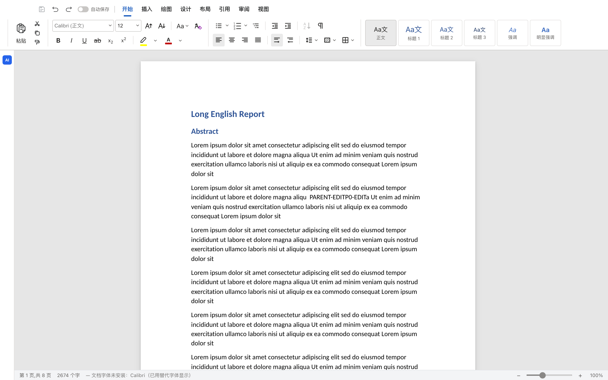

# Office 在线编辑

- DOCX：`/office/?embed=1&doc=<id>`
- XLSX：`/office/sheets/?embed=1&open=<id>`
- PPTX：`/office/slides/?embed=1&open=<id>`

构建：

```bash
./scripts/build-office.sh        # 三个编辑器 -> office-dist/
./scripts/build-xlsx-sidecar.sh  # Rust xlsx sidecar
```

工作台：产物面板中 `.docx/.xlsx/.pptx` → 在线编辑（全屏 iframe，带锁和版本）。
API：`/api/office/documents/{id}`、`/blob`、`/lock`、`/versions`；XLSX 还有 `/api/office/sheets/*`。

详细记录：
- [P0/P1](../plans/2026-11-05-office-p0.md)
- [P2/P3](../plans/2026-11-05-office-p2-p3.md)

  
