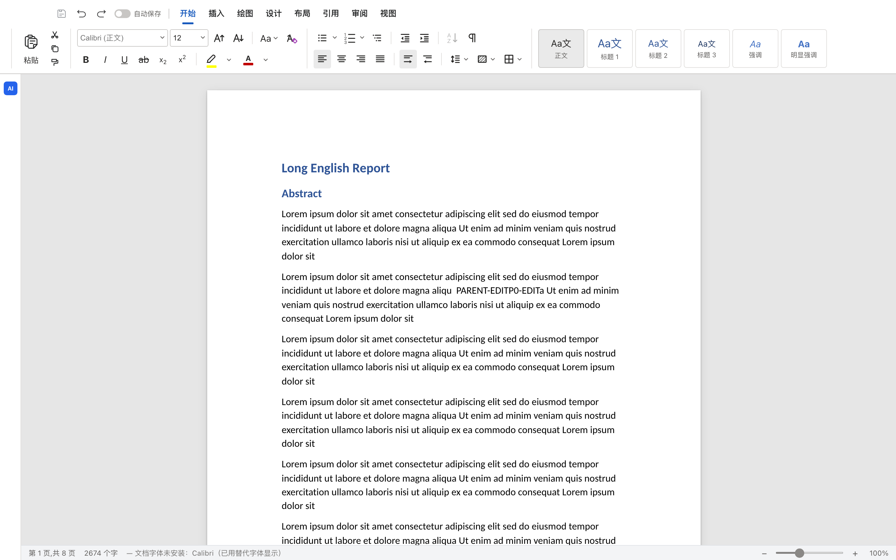
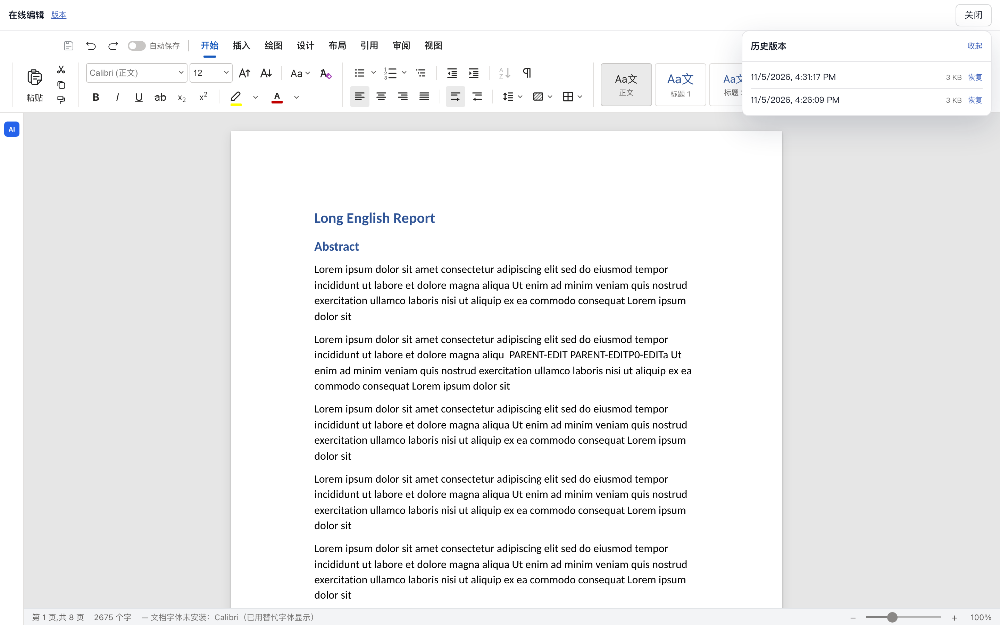

# Office P0（DOCX）实施记录

> 状态：**P0 完成；P1 锁/版本基础完成**。剩余：editor ticket、未保存关闭提示、构建/部署集成。

## 已完成

### 编辑器 fork

- `office/`：AIOffice docs renderer + `docx-engine` 等包的裁剪 fork；
- 独立 Vite 构建，产物 `office-dist/`，静态挂载到 `/office`；
- embed 入口：`/office/?embed=1&doc=<opaque-id>`，绕过 AIOffice Login/Home/Shell；
- 隐藏 AI 面板和 AI 工具组；
- 适配器 `web-adapter.ts`：
  - 文档打开/保存走 `/api/office/documents/{id}`；
  - 同源 cookie，不再使用 AIOffice Bearer token；
  - 保存成功向父页面发 `office:saved`；
  - 禁用 project/thumbnail 调用，避免无关 404/405。

### 后端

- `packages/pi-server/src/pi_server/office.py`：
  - 不透明 doc id（base64url JSON，含 workspace + 相对路径）；
  - 扩展名白名单 `.docx/.xlsx/.pptx`；
  - sha256、50MB 上限、原子写、`.pi/versions/` 旧版本备份。
- API：
  - `GET /api/office/documents/{id}`
  - `GET /api/office/documents/{id}/blob`
  - `PUT /api/office/documents/{id}/blob`（`If-Match`）
- `/office` 静态挂载（`PI_OFFICE_DIST` 可覆盖）。

### 工作台

- `.docx` 加入产物类型；
- 产物面板显示「在线编辑」；
- 全屏 iframe 编辑器，关闭按钮，保存后提示「已保存」并刷新产物；
- 保持下载兜底。

## 验证

- `office`：Vite build 通过；
- `web`：`npm run typecheck` / `npm run build` 通过；
- 后端：`tests/test_office_api.py` 2 passed；
- 手工 P0：
  - 打开真实的 `13-english-report.docx`（8 页、表格/样式）；
  - 在正文输入 `PARENT-EDIT`，点保存；
  - 服务端 docx 的 `word/document.xml` 含该文本；
  - 旧版本写入 `.pi/versions/...`；
  - 父页面收到保存消息并显示「已保存」。

## P1 基础（已完成）

- DB v13 `office_locks`；`POST/DELETE /lock`，TTL 120s；
- 前端打开前取锁，60s 心跳；409 显示“正在被另一位用户编辑”；
- `PUT blob` 和版本恢复要求匹配 `X-Office-Token`；
- `GET /versions` + `POST /versions/{id}/restore`；
- 编辑器顶部版本面板，恢复后重载 iframe。

## 已知限制（P1 剩余）

- 还没有 `editor ticket`，当前依赖同源 cookie；
- 编辑器 AI 入口只是隐藏，未桥接 python-pi；
- 只支持 `.docx`；xlsx/pptx 在 P2/P3；
- 构建产物未提交，部署需先 `cd office && npm install && npm run build`。

## P1 剩余

1. 把 `office-dist` 构建接入部署脚本（当前需要手动 build）；
2. editor ticket（为 iframe sandbox/跨域预留）；
3. 关闭未保存提示；
4. Playwright 自动化：打开→编辑→保存→重开、并发锁、版本恢复。
