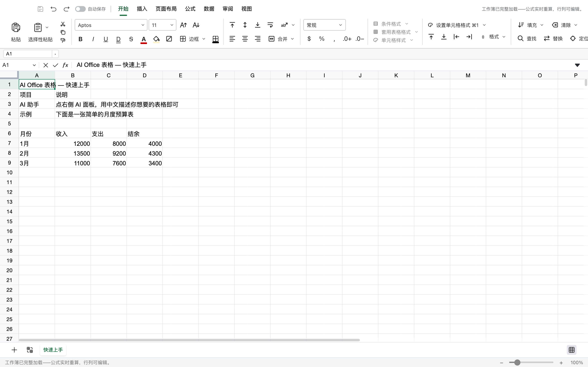
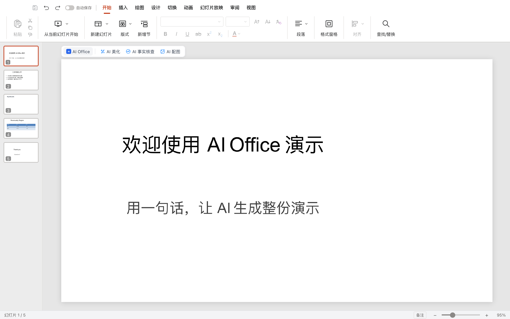

# Office P2/P3（XLSX + PPTX）实施记录

> 状态：**已实现并通过本地验证**。完整验收待你进行。

## P2 XLSX

- fork AIOffice sheets renderer 到 `office/apps/sheets/`；
- Univer 固定在 **0.25.1**，避免 0.25.1/0.25.2 混装导致的 duplicate injector；
- 后端新增 `/api/office/sheets/*`：
  - `open` / `read-range` / `read-formulas` / `read-media`
  - `recalc` / `manifest` / `read-entries` / `scan-entries`
  - `save` / `close`
- 复用 AIOffice 的 Rust `xlsx-sidecar`：
  - 源码在 `office/xlsx-engine/`；
  - `./scripts/build-xlsx-sidecar.sh` 构建；
  - 保存时由 sidecar `save_archive` 重组 xlsx，再原子写回 workspace + `.pi/versions/`。
- 工作台 `.xlsx` 产物显示「在线编辑」，iframe `/office/sheets/?embed=1&open=<docId>`；
- 隐藏 sheets 的 copilot 侧栏并修正 grid 宽度。

## P3 PPTX

- fork AIOffice slides renderer 到 `office/apps/slides/`；
- 复用 `pptx-engine` + `pptx-render` + Konva；
- 适配器把 open/save 指向 `/api/office`；
- 工作台 `.pptx` 产物显示「在线编辑」，iframe `/office/slides/?embed=1&open=<docId>`；
- 隐藏 slides 的 AI 侧栏（保留顶部 AI 工具入口按 P1 约定可后续隐藏）。

## 验证

- `office` build：docs / slides / sheets 全部通过；
- `web` typecheck/build 通过；
- 后端完整套件通过；
- 手工 Playwright：
  - XLSX：打开 `sheets-sample.xlsx`（9 行），编辑 B7 → 99999，保存后 `sheet1.xml` 包含 99999；
  - PPTX：打开 `ppt-sample.pptx`（5 页），调用 `slidesApi.save()` 保存成功，父页面显示「已保存」；
  - DOCX：打开/编辑/保存/版本恢复已验证。

## 已知限制

- XLSX 依赖 Rust sidecar；部署镜像必须构建对应平台二进制；
- XLSX 的 sidecar 会话是单进程内存态，暂不支持多副本共享；
- PPTX 复杂版式/字体仍有保真度差异；
- 三套 iframe 目前都依赖同源 cookie，editor ticket 未做；
- 关闭未保存提示、管理员强制接管锁未做；
- AI 面板已隐藏，未桥接 python-pi。
