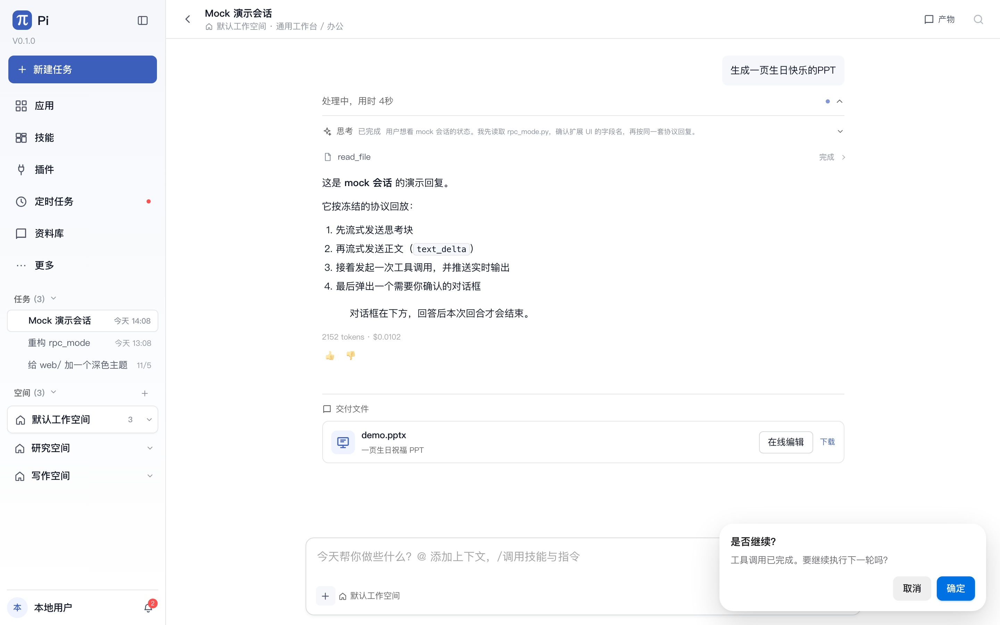
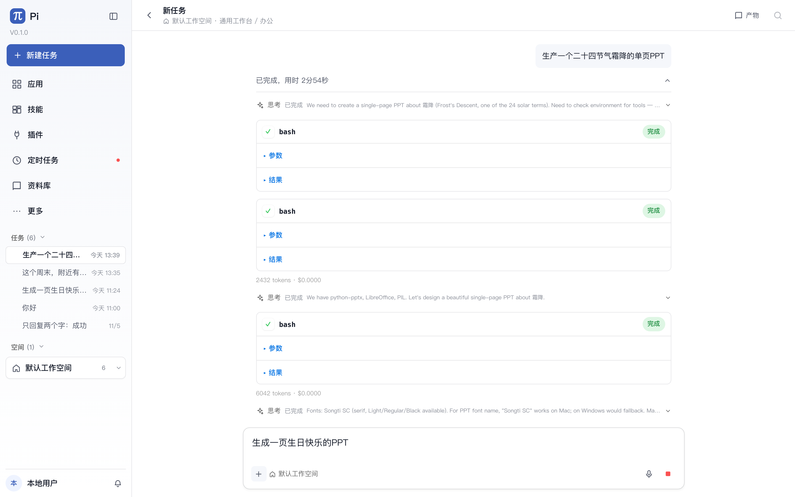
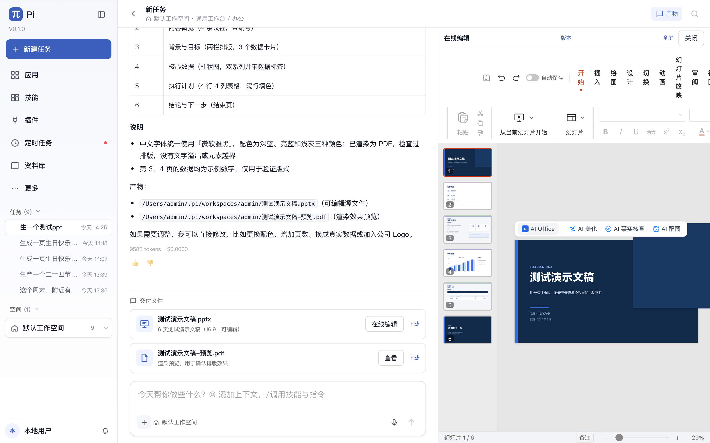
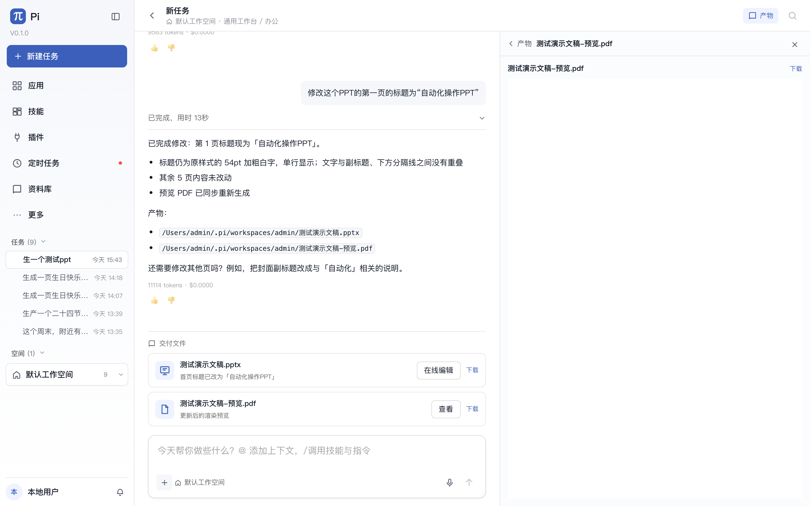
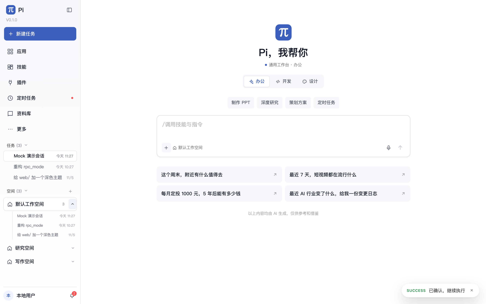

# 工作台修正：思考折叠 / 产物交付 / 用户工作空间 / 空间对话展开

> 2026-11-06。针对实际生成 PPT 时的四个问题修正。

## 1. 整轮过程折叠（对齐 DSH）

- 每个用户回合现在有一个 **整轮过程控制**：
  - 运行中：`处理中，用时 14秒`
  - 完成后：`已完成，用时 34分55秒`
- 思考、工具调用、中间回复全部收进这个控制下面；默认收起；
- 展开后不再有专用工具卡：思考、`运行命令`、`read_file` 等都是同样的小文本行；
- 思考、命令、文件操作行都可以单独点开查看详情；默认只显示标题、摘要和状态；
- **正在运行的行图标会闪烁**（`wb-live-blink`），表示这一行确实在产出；
- 20 秒没有新输出：显示「等待输出」，图标停止闪烁；
- 45 秒没有新输出：显示「可能卡住」（橙色），提醒模型/命令可能故障；
- 最终回答单独显示在下面，不再被过程打断；
- 运行结束自动收起整轮过程，保留最终回答。





## 2. 产物左右分栏

- 点击交付卡片的「在线编辑/查看」不再新开页面，而是打开聊天右侧的产物栏；
- DOCX/XLSX/PPTX 直接在右栏启动 Office 编辑器；
- PDF 和图片在右栏预览；
- 右栏可关闭，关闭后回到对话继续追问或重新生成；
- 点「产物」先显示整列文件列表；点某个文件后切换成**全宽查看模式**；
- 查看模式有「← 产物」返回列表；
- 编辑器右上角提供「全屏」切换。





## 3. 产物交付协议

新增内置 `present` 工具（`packages/pi-coding-agent/src/pi_coding_agent/tools/present.py`）：

```json
{"files": [{"path": "生日祝福.pptx", "description": "一页生日祝福 PPT"}]}
```

- 模型在文件最终完成后调用；
- 工具校验路径必须在当前 workspace、文件真实存在；
- 工作台从 transcript 的 `present` 工具调用生成「交付文件」卡片，固定显示在**本轮消息最后**；
- 卡片支持「在线编辑」（DOCX/XLSX/PPTX 走 `/office`）和下载；
- `present` 工具调用本身不再重复显示普通工具卡。

## 4. 每个用户独立工作空间

| 模式 | 默认工作空间 |
|---|---|
| 单人（start.sh） | `~/.pi/workspaces/<OS 用户名>` |
| 团队 | `<data_root>/workspaces/<用户名>` |

- `start.sh` 自动设置 `PI_SINGLE_WORKSPACE`，不再把 python-pi checkout 暴露给资料库；
- 单人模式保留旧的 session 目录，历史对话仍可见；
- 团队新用户使用用户名目录；已有用户的旧目录保持不动，避免移动对话；
- `/api/workspaces` 返回 `path`，侧栏 hover 可看到实际目录；
- 旧 `output/生日快乐.pptx` 已复制到本机新工作空间，避免丢失。

## 5. 空间对话可展开

- 每个空间行新增展开/收起按钮；
- 展开时按空间请求 `/api/sessions?workspace=...`；
- 子列表显示对话标题、时间，点击直接打开；
- 活动空间显示当前会话数，其他空间在加载后显示数量。



## 验证

- 完整套件：**672 passed**（含 sandbox）；
- `web` typecheck/build 通过；
- 手工 mock 验证：
  - 思考块默认折叠，回合结束自动收起；
  - `present` 卡片出现在聊天最后；
  - 空间展开后显示 3 个对话并可点击。

## 已知边界

- `present` 需要模型主动调用；若模型忽略该工具，本轮不会自动生成卡片；
- 团队旧用户目录不会迁移，只影响新用户；
- 单人的历史 session 目录沿用旧路径，新工作空间文件从空目录开始。
