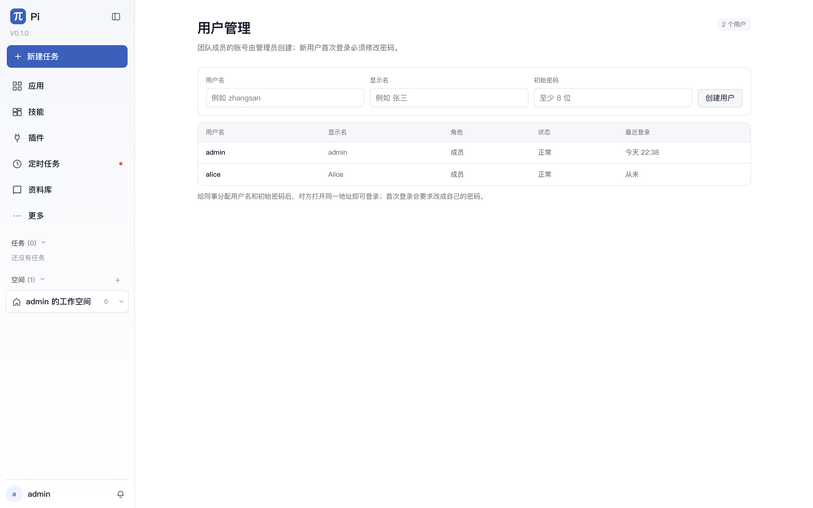
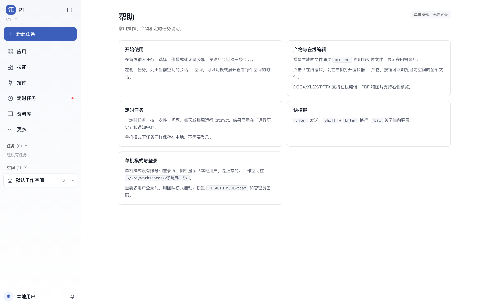

# 单机模式：登录说明、定时任务与帮助页

> 2026-11-06。修复单机模式下的定时任务 503，并补齐帮助页与「更多」菜单位置。

## 登录

`./start.sh` 现在默认是 **team（团队）模式**：

- 首次启动创建 `admin` 超级管理员；
- 没设置 `PI_ADMIN_PASSWORD` 时，随机密码只打印一次到终端；
- 启动后进入登录页，URL 仍是 `http://127.0.0.1:8787/#/workbench`。

需要临时切回无账号的单机模式：

```bash
PI_AUTH_MODE=single ./start.sh
```

单机模式没有登录页，侧栏显示「本地用户」是正常的。

## 团队默认模式

- 默认数据目录：`~/.pi/team`；
- 默认管理员：`admin`；
- 首次启动会创建管理员并打印随机密码；
- 团队用户各自的 workspace 在 `~/.pi/team/workspaces/<用户名>`；
- 每个用户使用独立的 agent 目录，模板来自 `~/.pi/agent` 的模型配置。

如果要保留原来的单机文件，可以把它们复制到对应团队用户的 workspace；不会自动迁移单机数据。

## 定时任务

原来 `/api/schedules` 和通知接口要求团队数据库，单机模式直接返回：

```
accounts are disabled (auth mode is 'single')
```

现在单机模式会创建独立的本地 SQLite：

```
<data_root>/local-schedules.db
```

- 使用内置的 `local` 用户；
- 定时任务、运行历史、通知都保存在本地；
- 不会打开账号/登录接口；
- 调度器仍然复用普通 worker 执行 prompt。

## 团队成员

团队模式首次启动只有 `admin`，没有开放注册。

管理员登录后：

1. 打开左下角「更多」；
2. 点击「用户管理」；
3. 输入用户名、显示名、初始密码，点击「创建用户」；
4. 把地址和初始密码发给成员；
5. 成员登录后会被强制修改密码。



成员不能自己注册；这是团队模式的安全默认值。

## 帮助页

- 「更多」菜单现在锚定在左侧导航的「更多」按钮下方，不再飘到侧栏底部；
- 点击「帮助」进入 `#/workbench/help`；
- 帮助页包含：开始使用、产物/在线编辑、定时任务、快捷键、单机模式与登录说明。



## 验证

- 单机模式 `/api/schedules` 创建/列表/删除通过；
- 单机模式定时任务页无 `accounts are disabled` 错误；
- 帮助页路由和「更多」菜单位置已用 Playwright 验证；
- 完整测试见最终报告。

## 边界

- 单机模式确实没有账号系统，这是设计而不是 bug；
- 本地定时任务数据库独立于团队 `pi.db`，单机与团队数据不互通。
