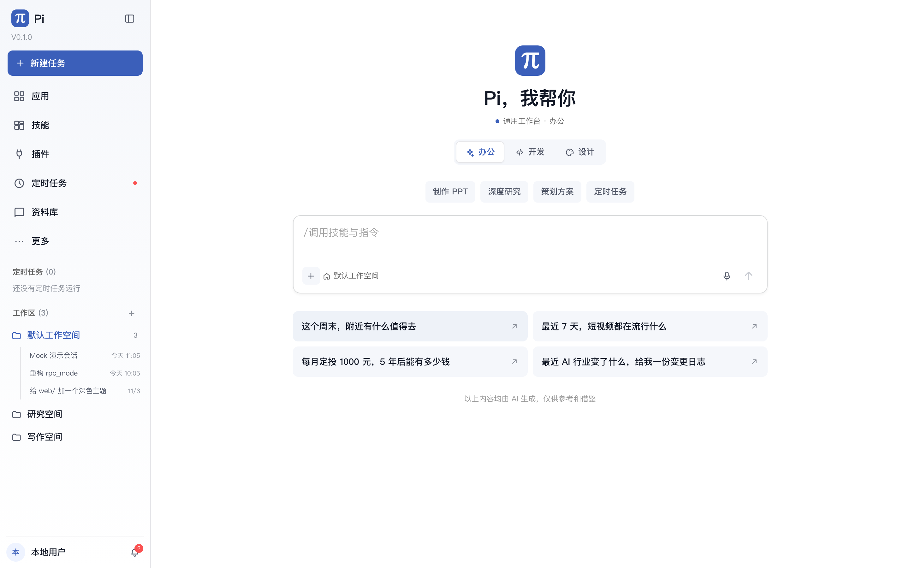

# 定时任务会话与工作区导航

> 2026-11-07。把「定时任务」从“在当前电脑上执行”改成“定时创建会话并让 AI 执行”，同时把普通对话收敛到工作区。

## 定时任务的语义

一次定时任务运行 = 新建一个会话 + 发送 prompt + 等待 AI 完成。

- 每个任务属于创建它的用户（uid），不会串到其他用户；
- 每次运行启动一个**临时 worker**，不切换用户当前正在看的会话；
- 临时 worker 运行完立即关闭，不会成为用户的 resume 目标；
- `schedule_runs.session_file` 记录本次新会话；
- 运行历史、通知和顶部「定时任务」列表都指向这个会话。

### 实现

- `SessionRegistry.acquire_scheduled()`：创建不注册到 registry 的临时 worker；
- `SessionWorker.run_scheduled_prompt()`：先发送 `new_session`，再发送 prompt；
- `ScheduleRunner` 使用临时 worker，结束后 `shutdown`；
- `GET /api/schedules/runs`：返回当前用户最近的所有运行，供侧栏展示。

## 侧栏

顶部「任务」改成「定时任务」，只显示定时任务的运行会话；普通会话不再出现在这里，而是在「工作区」里展开查看。

- 移除了定时任务/工作区标题右侧的箭头；
- 工作区行点击即可展开或收起；
- 工作区不再使用方框式选中样式，只用文字颜色表示当前工作区；
- 工作区里的列表会过滤掉定时任务创建的会话，避免重复。

## 验证

- 定时任务 runner 使用 `acquire_scheduled`（测试断言）；
- `/api/schedules/runs` 返回空列表和运行记录；
- 侧栏标题为「定时任务」「工作区」；
- 工作区没有独立的箭头按钮；
- `web` typecheck/build 通过。

## 边界

- 临时 worker 仍消耗一次模型调用和资源，但不会干扰用户当前会话；
- 定时任务运行期间如果模型不可用，运行记录标记失败并写通知；
- 旧的历史普通会话不会被删除，只是不再显示在顶部「定时任务」区域。
