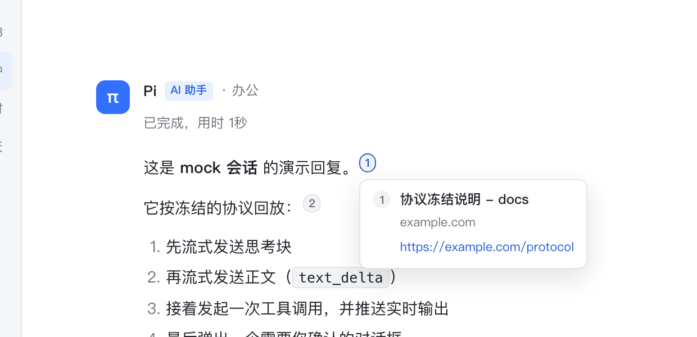
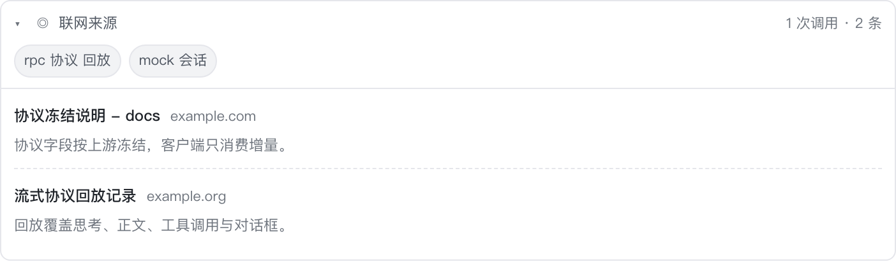

# DeepSeek「全家桶应用 API」、`chat-demo` 与其对 pi-agent 的启示

> 研究对象与时间：
> - 公众号文章《DeepSeek 发布全家桶应用 API》（`mp.weixin.qq.com/s/78KBHc4-4N5b2vfL9SkutQ`），2026-11-13 发布
> - 官方演示客户端 `https://github.com/deepseek-ai/chat-demo`（clone 于 `/tmp/chat-demo`，v0.1.1，MIT，约 150 文件 / 1.5 MB）
> - 官方文档：`create-message`、`guides/build_a_chatbot`、`guides/web_tools`、`guides/safety`、`guides/anthropic_api`、`quick_start/pricing`
> - **实测**：2026-11-18 用本仓库 `.env` 里的 `PI_API_KEY` 对 `api.deepseek.com` 跑了 8 个探针（见 §6），消耗约 4.5 万输入 / 4 千输出 token，≈ 6 分钱
>
> 目标读者：决定「要不要接、接哪一层、怎么接」的人。
> 约定：协议字段、文件名、函数名保持英文原文；叙述用中文；结论标注仓库内落地位置（`文件:行`）。

---

## 0. 结论速览

1. **这次开放的是「DeepSeek App 的产品能力」，不是新模型**：联网搜索、深度思考搜索、阅读链接、文件解析、内容安全、会话标题、用户元信息标记，外加可独立调用的 Search / Fetch / OCR / ASR / TTS；Messages、Responses、Chat Completions 三套协议都支持。
2. **`chat-demo` 是一份协议参考实现，不是 UI 玩具**。真正值得读的只有 3 个文件：`src/services/api/types.ts`（260 行，注释比文档还细）、`src/services/chat/reply.ts`（347 行，定义「历史怎么重建、什么能回传、什么不能续写」）、`src/services/api/parseEvent.ts`（231 行，事件白名单）。
3. **最重要的实测结论：pi-agent 现在走的 Chat Completions 路线，接入成本远低于 Messages 路线。** 在 `chat/completions` 上声明 `{"type":"deepseek_web_search","name":"deepseek_web_search"}` 就能联网（已实测 200），服务端行为全部落在**两个额外消息字段**里：`annotations`（带 `start_index`/`end_index` 的引用）与 `server_tool_calls`（带 `sources` 的调用记录）。**不需要新增流式块类型、不需要改 `_apply_event` 的块模型**。
4. **但 Messages 路线才能拿到「边搜边看」**：逐块下发 `server_tool_use` / `web_search_tool_result` / `web_fetch_tool_result`，顺序、并行、思考穿插都能看到（实测一次 deep_search 产生 22 条结果 + 5 次抓取 + 5 段思考）。Chat Completions 把这一切压成**最后那个 delta 里的一次性 lump**，没法做「正在搜索…」的进度。
5. **一条硬约束，文档里没有、实测才发现**：`deepseek_web_search` 与客户端工具**只能在思考模式下共存**。关掉思考时同请求返回
   `400 tools: client tools can only be used together with 'deepseek_web_search' in thinking mode`。
   这对 pi-agent 是决定性的——它是个十几个客户端工具的 agent，「关思考 + 联网」这个组合直接不成立。
6. **`deepseek_read_url` 没有上一条限制，但基本用不上**：关思考 + 客户端工具 + `read_url` 时请求 200，模型却选了客户端自己的 `bash` 去 curl 网页（实测）。agent 自带的抓取工具会稳定压过 `read_url`。
7. **pi-agent 现在对这一切是「静默降级」**：`_apply_event` 对 `server_tool_use` / `web_search_tool_result` / `web_fetch_tool_result` / `citations_delta` 没有任何分支，落到函数末尾 `return`（`anthropic_messages.py:668-735`），块被丢弃且不报错。反过来，`map_stop_reason` 遇到未知 `stop_reason` 直接 `raise`（`:520`）——同一份文件里同时有「悄悄丢」和「直接崩」。
8. **一处「白干」**：`_resolve_thinking` 精心实现的 `budget_tokens` 分级（`anthropic_messages.py:245-254`）在 DeepSeek 上是恒被忽略的字段。真正的旋钮是 `output_config.effort`（实测 200）。而 `/models` 返回的 `effort.supported_levels` 是 **`["low","high","max"]`，默认 `high`**——恰好等于 pi-agent `models.json` 里现有的 `thinkingLevelMap`，配置面早就对了，只是接错了线。
9. **拒答是安全地雷**：pi-agent 把 `refusal` 映射成 `error` 却**保留已流出的思考与正文**（`map_stop_reason:513`），而协议要求客户端删除；更麻烦的是服务端的最终审核发生在生成**之后**、连接关闭**之前**，拒答可能出现在「回答已经显示完」之后。
10. **「继续生成」在 pi-agent 里被代码显式禁止**（`loop.py:188`、`agent.py:283` 直接 `raise`），而 DeepSeek 的原生续写恰恰要求「消息以 assistant 结尾」且**不需要** Anthropic 的 `prefix` 字段。这是架构级冲突。
11. **计费口径变了**：2026-11-18 12:00 起服务端搜索/抓取**不再单独计费**（文章里的价格表已过时，那是独立 Search/Fetch API 的价）；模型有高峰/空闲双价（2 倍差），`~/.pi/agent/models.json` 只配单费率且 output 配 0.28，而实际空闲 4 元≈$0.56、高峰 8 元≈$1.12。
12. **对 agent 最实用的其实是独立工具 API**：Search 5 元/1000 次。pi-agent 的 `plugins/web-fetch` 在「抓取」上已经够用（含 SSRF 防护），缺的是「搜索召回 + 元数据（`snippet`/`page_age`/`site_name`）」。

---

## 1. 这次开放了什么

### 1.1 能力矩阵

| 能力 | 开启方式 | 客户端职责 |
|---|---|---|
| 联网搜索 | 声明 `deepseek_web_search`，**关思考** | 只渲染结果与引用 |
| 深度思考搜索 | 声明 `deepseek_web_search`，**开思考** | 同上；服务端自己 `search`/`open_page`/`find_in_page` |
| 阅读链接 | 声明 `deepseek_read_url` | 必须原样回传带 `signature` 的结果块 |
| 文件输入 | Files API 上传 → 消息里用 `file_id` | 先传再引 |
| 模型内容安全 | `"safety_check": {"level": "high"}` | 处理 `refusal`，丢弃已展示内容 |
| 会话标题 | `"title": {"enabled": true}` | 取 `message_delta.delta.title` |
| 用户元信息标记 | `messages` 里插入 `role: "latest_reminder"` | 拼「日期,星期,地区,平台,语言」 |

### 1.2 端点与模型

| 用途 | 端点 |
|---|---|
| Messages（Anthropic 兼容） | `POST /anthropic/v1/messages` |
| Files（Anthropic 兼容） | `POST /anthropic/v1/files` |
| Chat Completions | `POST /chat/completions` |
| Responses | `POST /responses` |
| 独立工具 | `/v1/tools/{asr,tts}`、Search / Fetch / OCR |

`GET /models` 实测（2026-11-18）：

```
deepseek-flash    context 1048576  max_output 393216  effort.supported_levels=[low,high,max]  default=high
deepseek-v4-pro   context 1048576  max_output 393216  effort.supported_levels=[low,high,max]  default=high
```

`deepseek-flash` = DeepSeek-V4.1-Flash-1017；`claude-opus*` 会被映射到 `deepseek-v4-pro`，其它 `claude*` 映射到 `deepseek-flash`，非 `claude` 开头的未知模型名 `400`。这意味着任何按 `claude-*` 写死模型名的客户端（Claude Code / OpenCode 等）改 base_url + key 即可接入。

### 1.3 计费（以文档为准，文章的表格已过时）

- 模型服务端搜索/抓取：**2026-11-18 12:00 起不再计费**，只算 token。
- 独立 API：Search / Fetch 5 元 / 1000 次成功请求；文件解析 + OCR 1.5 元 / 1000 页；TTS 3 元 / 万字（限时 1.5）；ASR 0.78 元 / 小时（限时 0.39）。
- 模型价高峰 = 空闲 × 2。空闲：输入未命中 1 元/M、命中 0.02 元/M、输出 4 元/M。
- 输入被审核拦下（`400 Content Exists Risk`）时，**输入 token 照计费**（按缓存命中价）。

---

## 2. `chat-demo` 代码解剖

### 2.1 结构

纯静态前端：React 18 + zustand + rspack + IndexedDB，**没有后端**，浏览器直连 API。

```
src/services/api/    client.ts(189) types.ts(260) parseEvent.ts(231) sse.ts(136) speech.ts(65) errors.ts(116)
src/services/chat/   reply.ts(347)  ← 上下文重建 / 流合并 / 续写判定
                     store.ts branches.ts backup.ts history/*（ZIP 导入导出）
src/components/search/  SearchPanel.tsx SourceCard.tsx CitationLink.tsx HoverCard.tsx
src/components/messages/ AssistantMessage ReadingBars ReadAloudButton BranchSwitcher
src/services/speech/ recorder.ts(132) readAloud.ts(144)
```

### 2.2 与 Anthropic 官方的差异（`types.ts` 注释里已写死）

| 项 | Anthropic 标准 | DeepSeek 实现 |
|---|---|---|
| 结束标志 | `message_stop` | 同，且**不发 `data: [DONE]`**（Messages 侧实测确认） |
| `message.id` | `msg_...` | 无前缀 UUID，**等于响应头 `x-ds-request-id`** |
| thinking 签名 | 独立字段 | `signature_delta` 在块结束前下发，**值就是本次响应 id** |
| 服务端工具块 | 增量 | `content_block_start` **一次性带全量**，无 delta |
| 工具名 | `web_search` | `deepseek_web_search` / `deepseek_read_url`，另带扩展 `kind`（`search`/`deep_search`/`read_link`/`image_search`/`deep_image_search`） |
| 工具 `input` | 自由 schema | 由 `action` 决定：`search{queries}` / `open_page{url}` / `find_in_page{url,pattern}` / `read_link{url}` |
| 引用 | `citations` | `citations_delta` 增量下发；**带引用的 text 块结束后，后续正文另起新块**，同块内同 URL 最多一次 |
| 流内错误 | — | 可能出现**无名 `data` 帧**只含 `{error:{message}}`，随后关连接 |
| 续写 | `prefix: true` | Messages 下**末尾 assistant 即触发**，无 `prefix` |

### 2.3 历史重建规则（`reply.ts`，最值得抄的一段）

`toRequestMessages()` 的规则比文档细：

1. **只保留「提问 + 有可用回答」成对轮次**；失败轮、无回答轮、被拒答轮、只含服务端模板提示的轮次都不进上下文。
2. **历史思考不回传**；只有「续写时本轮思考」带 `thinking` + `signature`。
3. **工具块只回传 `kind: "read_link"` 的**：`server_tool_use` 与 `web_fetch_tool_result` 成对保留 `signature`；搜索结果块（`search`/`deep_search`/`image_search`）**一律不回传**；缺 `signature` 的 read_link 调用与结果**成对丢弃**。
4. **文本块的 `citations` 去掉**（回传时服务端忽略）；相邻文本直拼，被思考/工具隔开的用空行连。
5. **`latest_reminder` 只在内容变化时插快照**（`previousReminder` 去重）。
6. **续写时末尾追加 assistant**，并保护：没有非空白正文或有效思考就**不追**（避免服务端拒空 prefill）。

`canContinueReply()`：`refusal` / `tool_use` / 出现任何服务端工具块 / 服务端模板文本 / `prefix === false`（出现过未完成客户端 `tool_use`）→ 不可续写；`stopped` 或 `done && max_tokens` → 可续写。与文档一致：**用过联网工具的回复续写会 400**。

### 2.4 拒答（`settleReply`）

```ts
// 已下发的思考与正文不能撤回，按协议要求由客户端丢弃，只保留工具块
if (reply.stopReason === 'refusal' && (block.type === 'thinking' || block.type === 'text')) return []
```

关键时序：生成结束后连接**不会立刻关闭**，服务端还要对完整输出做一次审核，之后仍可能以拒答结束。UI 必须能「把已显示的回答替换成拒答文案」。

### 2.5 文件与语音

- 上传：`POST /anthropic/v1/files`，`purpose` 必须排在 `file` 之前；PDF/Word/PPT 用 `rich_layout_recognition`，纯文本/代码/表格/电子书用 `user_data`，**图片不传 `purpose`**。
- 引用：图片 `image` + `source:{type:"file",file_id}`，且必须带 `anthropic-beta: files-api-2025-04-14`；其它文件用 `document`。**扩展模式（开搜索/安全/标题）下 `document` 会 400**——两条路互斥。
- 限制：单文件 64 MB（`user_data` 32 MB）、50 个、并发 3。
- ASR：`POST /v1/tools/asr`，multipart，WAV / Ogg Opus，≤120 s、≤8 MiB → `{text}`。
- TTS：`POST /v1/tools/tts`，`{text, voice_id, format:"pcm", filter_markdown:true}` → **裸 PCM 24 kHz 单声道 s16le**；服务端默认过滤代码块、表格、引用标记与长公式。

---

## 3. Chat Completions 侧的形态（实测，未在 demo 中出现）

demo 只走 Messages。但 pi-agent 现在走的是 Chat Completions（`~/.pi/agent/models.json` 里 `api: "openai-completions"`，`MODEL=deepseek-official/deepseek-flash`），所以我单独实测了这条路线——**结论是它便宜得多**。

请求：`tools: [{"type":"deepseek_web_search","name":"deepseek_web_search"}]`，无需思考模式，返回 200。响应 `choices[0].message` 多出两个字段：

```jsonc
{
  "role": "assistant",
  "content": "……DeepSeek于2026年11月13日正式发布“全家桶应用API”……",
  "reasoning_content": "……",
  "annotations": [
    { "type": "url_citation",
      "url_citation": { "url": "https://api-docs.deepseek.com/zh-cn/news/news261113/",
                        "title": "DeepSeek 发布全家桶应用 API | DeepSeek API Docs",
                        "start_index": 0, "end_index": 148 } }
  ],
  "server_tool_calls": [
    { "index": 0,
      "reasoning_content": "用户需要了解……我将同时进行多项搜索……",
      "calls": [
        { "index": 0, "id": "srvtoolu_ds_00_82a6…", "type": "deepseek_web_search",
          "kind": "deep_search",
          "action": { "type": "search", "queries": ["…","…","…"] },
          "status": "completed",
          "sources": [ { "type": "url", "url": "…", "title": "…", "snippet": "…" } ] },
        { "index": 1, "type": "deepseek_web_search", "kind": "deep_search",
          "action": { "type": "open_page", "url": "…" }, "status": "completed", "sources": [] }
      ] }
  ]
}
```

要点：

- **`annotations[].url_citation` 是 `content` 的字符偏移**（`start_index`/`end_index`），渲染角标不需要解析文本，比 Messages 的 per-block citations 更好用。
- **`server_tool_calls[].calls[].sources[]` 自带 `snippet`**，足以做「搜索结果卡片」。
- `usage.server_tool_use` 在 CC 侧只有 `tool_search` / `tool_fetch` / `tool_image_search`（**没有** Messages 的 `web_search_requests` / `web_fetch_requests`）。
- 流式：**CC 侧会发 `data: [DONE]`**（Messages 不发）；`annotations` 与 `server_tool_calls` 出现在**最后那一个 delta**，不是增量。也就是说 CC 路线天然没有「正在搜索」进度，但也不需要新增流式块类型。

一句话：**Messages = 过程可见、成本高；Chat Completions = 结果可用、成本低。**

---

## 4. 与 pi-agent 的逐项对照

### 4.1 provider 层（`packages/pi-ai/src/pi_ai/`）

| 能力 | 现状 | 位置 | 判定 |
|---|---|---|---|
| 服务端工具声明（Messages） | `_convert_tools` 只产 `{name, description, input_schema}`，服务端工具会被当客户端工具发上去、静默失效 | `anthropic_messages.py:442` | 缺 |
| 服务端工具声明（CC） | `openai_completions.py` 的 tools 转换同样不认 `type` 字段 | `openai_completions.py`（tools 构造处） | 缺，但改动最小 |
| `server_tool_use` 等块 | `content_block_start` 只认 `text`/`thinking`/`redacted_thinking`/`tool_use`，其余落到末尾 `return` → 块被丢；后续 delta 也因查不到 index 被丢 | `anthropic_messages.py:696-735` | **静默丢弃** |
| `citations_delta` | `content_block_delta` 无该分支 | `anthropic_messages.py:737-766` | 丢弃 |
| `annotations` / `server_tool_calls` | openai provider 只取 `delta.content` / `reasoning_content` / `tool_calls` | `openai_completions.py` | **丢弃（最可惜的一处）** |
| 引用存储 | `TextContent` 只有 `text`；`pi-ai`/`pi-server`/`web` 无「响应引用」概念（仓库里 `citation` 的 31 处命中全在插件的**文献引用格式**里，与此无关） | `types.py:51` | 缺（全链路） |
| 思考强度 | 发 `thinking.budget_tokens`（被忽略）；不发 `output_config` | `anthropic_messages.py:245`、`build_params:496` | **接错线** |
| 历史回传 | `_convert_messages` 只认 `TextContent`/`ThinkingContent`/`ToolCall`/`ToolResultMessage`；`signature` 无处存放 | `anthropic_messages.py:280` | 缺 |
| `redacted_thinking` | 回传 `{"type":"redacted_thinking","data":…}` | `anthropic_messages.py:312` | DeepSeek **不支持** |
| 拒答 | 映射成 `error`，**保留**已流出的 thinking/text | `map_stop_reason:513` | 安全语义缺失 |
| 未知 stop_reason | `raise ProviderError` | `anthropic_messages.py:520` | 脆弱 |
| `Usage` | 无 `server_tool_use` 计数、无 `safety_tokens` | `types.py:101` | 缺 |
| 成本 | 单费率；`deepseek-official` output 配 0.28 | `~/.pi/agent/models.json` | 高峰低估 2~4 倍 |
| 模型目录 | `deepseek-flash` 已存在，`reasoning:true`，`input:["text","image"]`，`thinkingLevelMap` 已是 low/high/max | 同上 | 基本对 |

### 4.2 agent 层

| 能力 | 现状 | 位置 | 判定 |
|---|---|---|---|
| assistant 结尾续写 | 显式 `raise: Cannot continue from message role: assistant` | `loop.py:188`、`agent.py:283` | 与 DeepSeek 原生续写相反 |
| 会话标题 | `prompt[:60]` 截断 | `db.py:437` | 可白拿 `title` |
| 服务端块参与工具循环 | 若解析成 `ToolCall`，agent 会真去执行 `deepseek_web_search` → 必失败 | `loop.py` 工具分派 | **必须建独立类型** |
| 日期/地点注入 | 无 `latest_reminder` 概念 | — | 缺（可替代：注入 system prompt） |
| 联网 | `plugins/web-fetch`：SSRF 防护、1 MB / 20 s / 5 跳 | `plugins/web-fetch/main.py` | 抓取够用，**搜索缺失** |

### 4.3 展示层

- `web/src/lib/protocol.ts:379` 是 12 种 `AssistantMessageEvent` 的判定来源；新块类型必须同时出现在这里、`useAgent.ts:228` 的 `applyAssistantEvent`、以及渲染处，否则前端按未知块忽略。
- 参考实现里 `search/SearchPanel.tsx`、`search/SourceCard.tsx`、`search/CitationLink.tsx`、`messages/ReadingBars.tsx`（搜索中动效）是「联网观感」的全部来源——比协议本身更影响体感。

---

## 5. 建议路线

### 5.0 两条路线怎么选

| | Route B：Chat Completions（现状） | Route A：Messages（Anthropic provider） |
|---|---|---|
| 接入改动 | 两个响应字段透传 + Usage 计数 | 3 个内容类型 + 5 个流式事件 + 历史回传规则 + UI |
| 搜索过程可见性 | 无（最后一次性 lump） | 有（逐块、含并行与思考穿插） |
| 引用渲染 | `annotations` 字符偏移，最省事 | per-block `citations`，需处理「块被引用截断」 |
| `read_link` / `signature` 回传 | CC 侧未提供等价字段（实测 `server_tool_calls` 无 signature） | 原生支持 |
| Files 的 `document`（PDF/Office） | 不支持（Anthropic 兼容层的特性） | 支持 |
| `latest_reminder` 角色 | 文档只给了 Messages 形态 | 支持 |
| 风险 | 依赖两个非标准字段的长期稳定性 | 依赖 DeepSeek 对 Anthropic 扩展块的兼容 |

**结论：B 先做，A 按需。** 理由：B 的价值/成本比高一个数量级，且是「今天就能上线」的；A 的价值集中在「边搜边看」与文件/续写，属于产品差异化，而不是能力有无。

### P0（半天 ~ 1 天）：Route B 透传

1. `openai_completions.py`：在流式装配处保留 `annotations` 与 `server_tool_calls`，落到 `AssistantMessage.deferred`（`types.py:137`，此字段目前只被透传、没有被任何逻辑消费，正好是为「只在某个 provider 内有意义、但必须原样回传」的数据准备的）。
2. `Usage`（`types.py:101`）加 `tool_search` / `tool_fetch` / `tool_image_search` / `safety_tokens`；`openai_completions` 的 usage 分支读取 `usage.server_tool_use` 与 `completion_tokens_details.reasoning_tokens`。
3. `models.json`：`deepseek-official` 的 output 改 0.56（或加 tiers 表达高峰/空闲），并注明汇率与时段假设。
4. 断言：先用一条最小用例把「开 `deepseek_web_search` + 现有工具集」跑通，确认 §6 的思考模式约束在 CC 侧同样成立。

### P1（2~3 天）：把来源显示出来

1. `web/src/lib/protocol.ts` 给 `AssistantMessage` 加可选 `annotations`；`useAgent.ts` 落库；`AssistantMessage` 渲染时按 `start_index`/`end_index` 插角标，hover 卡片显示 `title` + `url`。
2. 搜索结果面板：从 `server_tool_calls[].calls[].sources[]` 取 `snippet`/`title`/`url`，复用现有 `ToolCard.tsx` 的折叠样式即可，不需要新组件体系。
3. 拒答：新增 `refusal` 收尾路径（丢弃 thinking/text、保留工具块、UI 换拒答文案）。**对外服务时这是合规项，不是体验优化。**

### P2（按需）：Route A + 独立工具

1. `output_config.effort`：把 `_resolve_thinking` 改成「DeepSeek 用 effort，Anthropic 用 budget_tokens」，`effort` 取值从 `model.thinking_level_map` 来（现有配置已是 low/high/max，正好对齐）。这是一处**只改 20 行、立刻纠正静默失效**的修复。
2. 独立 Search/Fetch（5 元/1000 次）作为 agent 的 `web_search` 工具：比服务端工具更适合 agent（结构化、可多次调用、可进工具循环）。**对 agent 而言它的价值高于 P1 的联网。**
3. Files API（`rich_layout_recognition`）换服务端版面解析；注意与扩展模式互斥。
4. `title` 替换 `db.py:437` 的截断标题；ASR/TTS 给 web 工作台加语音。

---

## 6. 实测记录（2026-11-18，`api.deepseek.com`）

> 全部用本仓库 `.env` 的 `PI_API_KEY`，`deepseek-flash`。

| # | 探针 | 结果 |
|---|---|---|
| 1 | 关思考 + 客户端 `bash` + `deepseek_web_search` | **400** `tools: client tools can only be used together with deepseek_web_search in thinking mode` |
| 2 | 开思考 + 客户端 `bash` + `deepseek_web_search` | **200**，thinking 541 字带 signature |
| 3 | 开思考 + 客户端工具 + 搜索（新闻类问题） | **200**：1 次 search（22 条结果）→ 5 次 open_page → 5 段 thinking → 33 个内容块；`usage.server_tool_use={web_search_requests:1, web_fetch_requests:5, tool_search:3}` |
| 4 | 关思考 + 客户端 `bash` + `deepseek_read_url` + 正文含 URL | **200**，但模型选了客户端 `bash`（`{"cmd":"curl -sL …"}`），没用 read_url |
| 5 | 关思考 + 仅 `deepseek_read_url` | **200**：`read_link` 调用 + 结果，`signature` 1904 字符，`data` 恒空，`tool_fetch:1` |
| 6 | Messages 流式 + 搜索 | 无 `[DONE]`；有 `ping`；服务端块原子；**并行调用先全部下发再下发结果**；本次以 `stop_reason=tool_use` 结束并请求客户端 `bash` → **「服务端搜索 + 客户端工具」同轮可共存** |
| 7 | CC 非流式 + 搜索 | **200**，`annotations`（url_citation，带字符偏移）+ `server_tool_calls`（含 `sources[].snippet`）；`usage.server_tool_use` 只有 `tool_search`/`tool_fetch`/`tool_image_search` |
| 8 | CC 流式 + 搜索 | **有 `[DONE]`**；`annotations` 与 `server_tool_calls` 只在**最后一个 delta**；中间有 12 个空 delta |
| 9 | `output_config:{effort:"max"}` + `thinking.budget_tokens:1024` | **200**（budget_tokens 被忽略，effort 生效） |

探针成本：约 4.5 万输入 / 4 千输出 token ≈ 6 分钱。

### 仍未验证（留给实现时确认）

- `redacted_thinking` 回传是否真的 400（需构造能产生它的响应，实测未触发）。
- `refusal` 的实际时序（需可复现的敏感输入，未做）。
- CC 侧 `server_tool_calls` 是否包含 read_link 的 `signature`（本次只有 deep_search，`sources` 为空、无 signature）。
- `max_tokens` 384K 的实际长尾延迟（本次最大只用到 600~1024）。
- 高峰时段（北京时间 9:00-12:00 / 14:00-18:00）的计费归属是否按请求时刻判定。

---

## 7. 三条架构判断

1. **服务端联网工具不是 agent 工具的超集，是另一条产品线**。它的约束（客户端不执行、约 20 次上限、关思考不能与客户端工具共存、用过不能续写）都是为「一次问答」优化的；pi-agent 的循环是「多步执行 + 结果回灌」。**正确做法是当成可选能力层，而不是替换 `plugins/web-fetch`。**

2. **「静默降级」比「崩溃」更危险**。`_apply_event` 遇未知块就 `return`、`map_stop_reason` 遇未知就 `raise`，两种极端并存。P0 的真正价值不在联网，而在把「未知块」变成「可观察事件 + 会话文件留痕」——这对任何 provider 扩展都有效。

3. **`deferred` 字段早就是为此准备的**。它目前只被 provider 间透传、没有任何逻辑消费（`types.py:137`）。「只在某个 provider 内有意义、但必须原样回传」的数据（`signature`、`annotations`、`server_tool_calls`）恰好符合它的定位：不污染统一消息模型，又保证回传保真。**Route B 的 P0 应该走 `deferred`，不要立刻扩 `AssistantContentBlock`。**

---

## 附：可复核来源

| 内容 | 位置 |
|---|---|
| 协议类型与字段 | `/tmp/chat-demo/src/services/api/types.ts`（注释即文档） |
| SSE 解析与错误分类 | `src/services/api/client.ts`、`sse.ts`、`errors.ts` |
| 历史重建 / 续写 / 拒答 | `src/services/chat/reply.ts` |
| 事件白名单 | `src/services/api/parseEvent.ts` |
| 文件 purpose 与限制 | `src/services/attachments.ts` |
| 语音 | `src/services/api/speech.ts`、`services/speech/*` |
| 官方协议 | `/zh-cn/api/create-message`、`/zh-cn/guides/anthropic_api` |
| 联网工具块语义 | `/zh-cn/guides/web_tools` |
| 拒答与 `safety_tokens` | `/zh-cn/guides/safety` |
| 价格与时段 | `/zh-cn/quick_start/pricing` |
| 实测原始响应 | `/tmp/probe2.out`、`probe3.out`、`stream.txt`、`cc.out`、`cc2.out`、`cc_stream.txt` |

---

## 8. 落地记录（2026-11-18）

本报告 §5 里被采纳的四项已实现并验证：

| 项 | 实现 | 验证 |
|---|---|---|
| 历史思考不回传 | `_convert_assistant_message` 只在「末尾 prefill」或「带工具调用」时保留 reasoning；`anthropic_messages._convert_messages` 同理（历史思考丢弃，工具轮保留） | `test_openai_drops_history_reasoning_but_keeps_tool_loop_reasoning`、`test_anthropic_drops_history_thinking_except_tool_loops_and_prefill` |
| 续写末尾追加 assistant + 空 prefill 保护 | 末尾 assistant 判定为 prefill：Chat Completions 加 `prefix: true` 并切到 `/beta/chat/completions`；空白或只有无效思考的尾巴直接丢弃；用过服务端工具的回复不续写（否则 400） | `test_openai_prefill_keeps_thinking_and_uses_beta_endpoint`、`test_openai_empty_prefill_is_dropped_and_stays_on_stable_endpoint`、`test_openai_does_not_prefill_a_reply_that_used_server_tools`；真机续写实测从「杭州是」续出「浙江省省会…」 |
| 引用角标 + hover 卡片 | `AssistantMessage.annotations` 透传到 web；`web/src/lib/citations.ts` 按字符偏移注入 `<sup data-cite-idx>`，`components/Citations.tsx` 负责 hover 卡片 | 13 条 helper 断言（`npm run verify:citations`）+ 浏览器截图 |
| 联网来源面板 | `AssistantMessage.server_tool_calls` → `SourcesPanel`（`<details>` 折叠，查询词 chip + 标题/域名/摘要） | 同上 |

界面效果（mock 数据，`MOCK_CITATIONS=1`）：






**开关**：`compat.serverTools: ["deepseek_web_search"]`（见 README「联网搜索与来源（可选）」）。
默认不开启——一次 deep_search 会产生约 20 次服务端调用、近万输入 token。

**仍然保留的未做项**（与 §5 一致）：`output_config.effort`、`Usage.server_tool_use` 计数、
`refusal` 收尾、Files API、ASR/TTS、会话标题。
