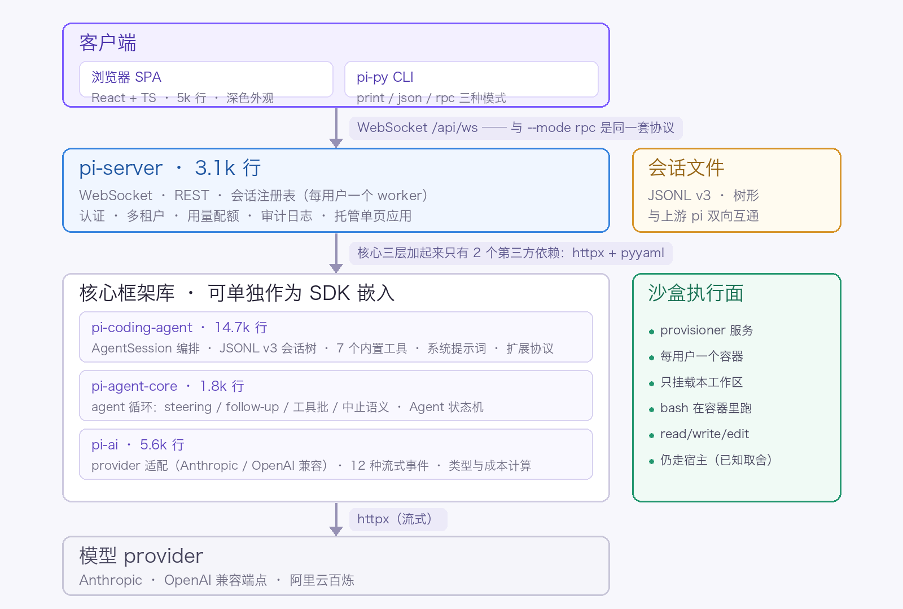
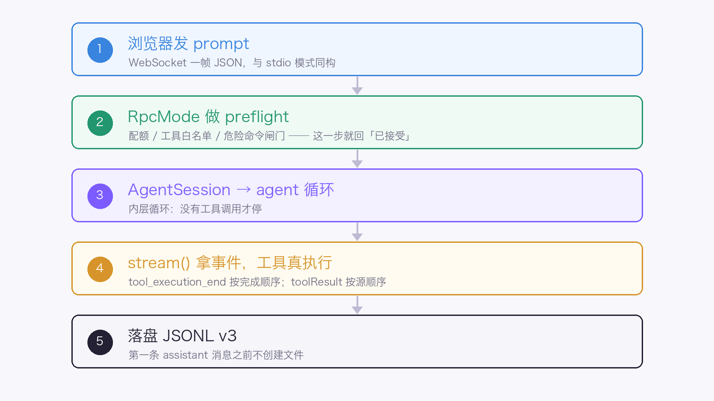
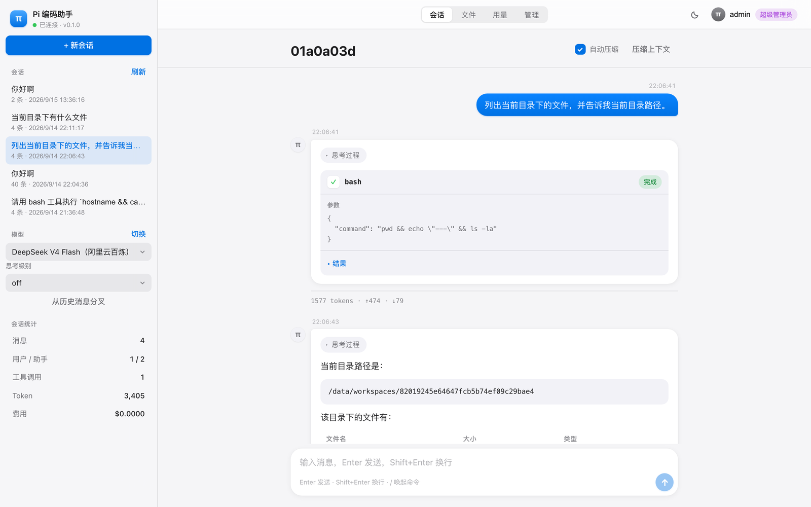
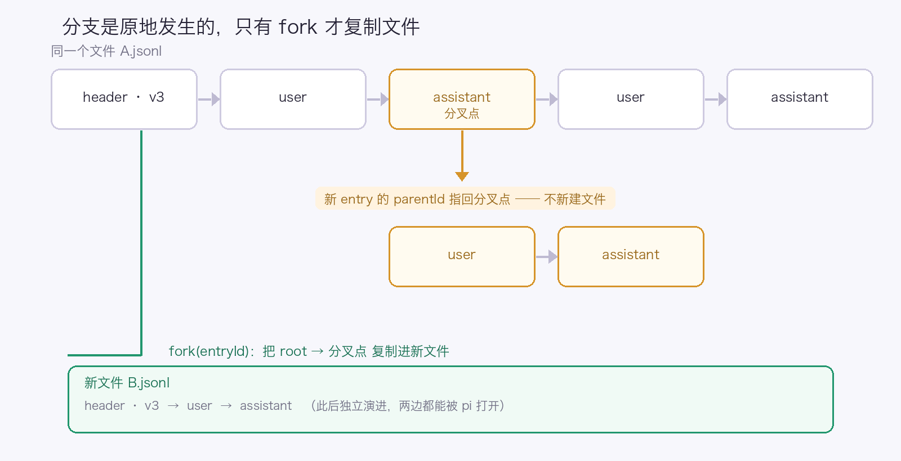

# python-pi：开源的多租户 coding agent harness

> python-pi 是一个开源的多租户 coding agent harness。它的上游 pi 是 11 个 npm 包、约 18 万行 TypeScript，我们把它移植成 Python（25.2k 行），再加了一套浏览器 UI 和团队多租户部署，588 个测试全部离线可跑。这篇文章讲的是移植过程中我给自己划的一条线：**能逐字对齐的地方，就不要"改进"**，以及这条线踩出来的 16 个坑。

先给结论：**这次移植里最贵的产出不是代码，是一份「不许改」的清单。**

pi 是一个极简终端 coding harness——核心保持很小，靠扩展、skills、prompt 模板向外生长。我们要的是两件上游没有的东西：一套能嵌进 Python 技术栈的 agent 框架，和一个内网多人可用的自托管编码助手。

真正开始动手的第一周，我就撞上了一个反直觉的事实：**把 TypeScript 翻译成 Python 是容易的，难的是忍住不去"顺手改成 Python 该有的样子"。**

## 一、先想清楚「什么不搬」，比想清楚「怎么搬」更重要

移植最大的风险不是写不出来，而是把不该搬的东西搬过来。

我先把上游源码逐层读完（调研笔记留了五份），得到三个**结构性发现**，它们直接决定了边界：

**1. 裸 agent 循环是自包含的。** 上游 packages/agent 里 types、agent-loop、agent、stream-fn 四个文件加起来约 1.6k 行，对 harness 目录**零 import**。而 harness 那约 12k 行是一个附加的持久化运行时（会话树 + 操作状态机 + 意图结算），**不是最小移植的必需品**。

**2. chord 的完整内核只在实验代码里用。** experimental 目录之外，没有任何非实验代码 import 它。

**3. CBOR 远程栈和 `--mode rpc` 是两套协议。** 前者是实验性 devDependency，后者才是稳定的集成方式。

顺着这三条往下推，"不搬清单"自然就出来了：TUI（18k 行，独立大工程）、harness 持久化运行时、CBOR 协议栈、SQLite 会话后端、telemetry、evals。

**结果就是 18 万行 → 3 万行。** 差的不是能力，是**刻意不搬**。

## 二、最终长成四层，核心三层只有两个第三方依赖



依赖严格单向，每一层都可以单独用：

- **pi-ai（5.6k 行）**——provider 抽象。消息/内容块/Usage/Model 的类型与 JSON 互转、12 种流式事件的 `EventStream`、provider 注册表、Anthropic 与 OpenAI 兼容适配器、工具参数校验、成本计算。
- **pi-agent-core（1.8k 行）**——agent 循环（steering / follow-up / 工具批 / 中止语义）+ `Agent` 状态机。**1.8k 行，可以单独拿去驱自己的工具。**
- **pi-coding-agent（14.7k 行）**——全部业务：JSONL v3 会话树、7 个内置工具（read/write/edit/bash/grep/find/ls）、系统提示词组装、skills、settings、会话编排、print/json/rpc 三种模式、扩展协议。
- **pi-server（3.1k 行）**——上游没有的一层。把同一套命令协议架在 WebSocket 上，加认证、多租户、配额、审计，并托管 React 单页应用。

**核心三层加起来只引入两个第三方包**：httpx 和 pyyaml。pi-agent-core 一个新依赖都没加，pi-server 才多出 fastapi + uvicorn[standard]（[standard] 是必需的，裸 uvicorn 根本不接受 WebSocket 连接）。前端也只要 4 个运行时依赖。

上游用到的 typebox、partial-json、proper-lockfile 这些，在 Python 侧用内联实现、json 容错解析和标准库顶掉了。**能自己写三十行解决的，就不装一个包。**

## 三、16 条「不许改」的语义

这是全文最重要的一节。

移植时我**刻意没有**按 Python 的习惯改写下面这些行为。因为它们是**可观察契约**——上游用户看得见、测试钉死了，改了就是行为变更，不是风格差异。

挑四条最反直觉的展开：

### 3.1 `partial` 是所有事件共享的同一个可变对象

```python
async for event in stream(model, context, options):
    if event.type == "text_delta":
        # event.partial 就是那个 live 的 AssistantMessage
        # 它不是快照，而且下一帧还会被原地改写
        pass
```

如果你习惯性地把 `event.partial` 存进列表准备"最后统一处理"，你拿到的会是**同一个对象的最终态**，前面几帧的内容全部丢失。这里是"原地修改"，不是"每事件生成一份"。

### 3.2 两个方向相反的错误契约

`stream()` **绝不**因为 setup 失败抛异常，它把失败编码成一个 `error` 事件；而 `stream_simple()` **可以同步抛**。

同一个库里的两个 API，错误处理方式刻意相反。原因很实际：**首次配置检测依赖同步抛出**。如果你出于"统一风格"把它们改成一致，就会静默破坏调用方的初始化探测。

### 3.3 `stop_reason == "length"` 时，整批工具调用都不执行

不是"执行一部分"，也不是"执行到哪算哪"——**整批都不执行**，全部报错，让模型重新发起。

### 3.4 两处 hook 的异常语义不同

`before_tool_call` 抛异常 → 变成一个 error tool result；`after_tool_call` 抛异常 → **结果被丢弃**。同样是"抛异常"，两条路径的后果完全不同。

其余 12 条我列成清单放在仓库的架构文档里，这里只给几个最容易被"顺手改掉"的：

- EventStream 是 push 队列：完成事件本身仍要投递给迭代方；`result()` 在首个 done / error 时即 resolve，**不等 `end()`**；
- `terminate`：只有批次内**每一个**结果都是 terminate 时，才终止循环；
- 并行工具执行：`tool_execution_end` 按**完成顺序**发，toolResult 消息按**源顺序**装配；
- `AbortSignal` 是**被观察的标志**，不是 `CancelledError`——中止时循环会合成一个 "Operation aborted" 的工具结果并正常发事件；
- `clampThinkingLevel` 的方向是"**就高不就低**"：先往更强找，再往更弱找；
- 成本分档基于 input + cacheRead + cacheWrite，用严格大于命中最高阈值档；1 小时缓存写入按 2× input 计价；
- 消息时间戳是**毫秒整数**，会话 entry 的时间戳是 **ISO 字符串**——同一个项目里两种单位。

最后一条值得单独说，因为它是 Python 最容易踩的一个：

```python
# 错：把「显式 null」和「没有这个键」当成一回事
if mapping.get("minimal"):
    ...

# 对：键不存在 = 用 provider 默认；显式 null = 不支持
if "minimal" in mapping and mapping["minimal"] is not None:
    ...
```

Python 的 `dict.get()` 把这两种情况合并了，而它们的语义完全不同。

## 四、一次 prompt 走完的真实链路



浏览器说的就是 --mode rpc 那套协议，**只是把传输从 stdio 换成 WebSocket**。所以任何为 pi RPC 写的客户端，改个地址就能连浏览器这层；反过来，这里验证过的协议行为对 stdio 同样成立。

**它没有另造第二套 API。** 30 个命令（`prompt` / `fork` / `compact` / `get_tree` …）原样复用，不支持的 3 个会返回带原因的错误响应，而不是静默挂起。

这是团队模式下的真实界面——会话、用量、成员管理、审计，全部建在同一套协议之上：



顺手记三个协议层的坑，都不是"写错了"，而是"想当然会死"：

**1. 帧层不能用 `splitlines()`。**

RPC 是严格 LF 分帧的 JSONL。Python 的 `str.splitlines()`（以及 Node 的 `readline`）会把字符串**内部**的 U+2028 / U+2029 当成换行，把一条记录撕成两半。实现必须是原始字节读取 + 显式 UTF-8 解码。

**2. 出站帧必须用与 stdio 相同的序列化器。**

浏览器这层把 stdio 传输换成了 `emit` 回调。如果把出站序列化换成严格编码的 `send_json`，遇到非纯 JSON 载荷会抛异常——而**同步的 emit 回调没法把这个异常传回去**，发送任务会静默死掉。表现是"流到一半卡住"，排查起来极难。

**3. 需要用户作答的对话框，只发给一个标签页。**

同一个 `confirm` 在三个标签页里同时弹出、再等最先作答的那个，比只问一次更糟。id 唯一，所以过期应答会被忽略。

## 五、会话文件：把最贵的数据资产做成通用格式



会话文件就是 pi 的格式：`<agent_dir>/sessions/--<cwd>--/<ts>_<id>.jsonl`，JSONL、version 3，靠 `id` / `parentId` 构成**树**。

有个必须复刻的怪癖：**第一条 assistant 消息落盘之前，不创建文件。**

两种分叉方式，语义完全不同：

- **分支是原地发生的**——同一个文件里继续 append，新 entry 的 parentId 指回分叉点，不新建文件；
- **`fork()` 才复制文件**——把 root→entry 的路径复制进一个新文件。

再加上"能读 v1/v2 并在写回时迁移到 v3"、"字段名逐个对齐（`stopReason` / `toolCallId` / `cacheRead` …）"、"`undefined` 省略语义一致"，Python 版写的会话，pi 能打开；pi 写的会话，Python 版能读。

**为什么值得花这个力气**：会话是这类工具最贵的数据资产。格式统一意味着两边可以互相打开，也意味着我们不用维护第二套 schema。代价是会被别人的 schema 绑住——这是笔明确的交易，不是免费的。

## 六、多租户：隔离的边界画在哪

加 `--auth-mode team` 就能内网多人共用，每人一个工作区、一个配置目录、一个独立会话。有三处是**必须这么做**的：团队模式下拒绝加载用户扩展（per-uid 的扩展目录等于给每个同事一个**以服务进程权限运行的 RCE 入口**，所以政策扩展是内置、强制加载、用户不可关的）；子进程环境按变量名白名单构造，剔除 `*_KEY` / `*_TOKEN` / `*_PASSWORD`，共用的 API key 也不能走命令行参数（`ps aux` 对同机所有账号可见）；`bootstrap` 的 `SystemExit` 要收敛成 `BootstrapError`，因为它继承自 `BaseException` 而不是 `Exception`，在服务端会直接击穿请求处理。

**但必须说清楚：白名单 + 审批不是沙盒。** 它防的是误操作，防不住恶意；真实边界是容器（`PI_SANDBOX_BACKEND=provisioner` 时每条命令都在只挂载本工作区的容器里跑）。而且沙盒只覆盖命令执行，`read`/`write`/`edit` 仍由服务进程直接读写工作区。另外，会话状态在进程内存里，**单进程是硬约束**，横向扩展得先换掉注册表。

这句话我同时写进了文档、代码注释和界面提示——**不给使用者虚假的安全感**，比多一个特性重要。

## 七、没有 API key，588 个测试怎么全绿

这是我个人觉得这个仓库最值得借鉴的部分。

**31 个测试文件、588 个测试函数、14.8k 行，全部离线，不访问网络、不需要任何 API key。** 三根支柱：

**1. 上游对齐。** 关键行为是逐字对齐而不是"大致相同"，所以断言可以直接抄上游测试——agent 循环的 12 事件序列就来自上游的断言。

**2. 黄金用例。** 会话存储有手工构造的 v3 JSONL 黄金文件，验证读取、上下文重建与再序列化。字节保真度还额外用 node 的 `JSON.stringify(JSON.parse(line))` 交叉验证过一遍。

**3. 真实线格式。** provider 适配器用 `httpx.MockTransport` 喂入固定的 SSE 字节，断言到**请求体字段级**——不是断言"调用了某个方法"，而是断言发出去的 JSON 长什么样。

再往上一层是 **CLI 端到端**：起一个本地假 OpenAI 兼容服务，以**子进程**运行真实的 pi-py，完整走通"加载配置 → 解析模型 → 读凭据 → SSE 流式响应 → 装配流式工具调用 → 执行真实工具 → 落盘 v3 会话"。同一批测试里还有通过真实管道驱动 --mode rpc 的用例（命令/响应相关性、事件流、坏行恢复、EOF 退出）。

关键点是：**这些都是确定性的**。跑一万遍结果一样，不需要网络，CI 里没有 flaky。

## 八、明确不做的事，和已知的坑

- **对真实 provider 没有做过在线验证**——开发环境没有任何 API key。首次接入新 provider 时，请先用一个小 prompt 验证适配器，别直接上生产。这是这个项目最大的验证缺口，我不想含糊过去。
- `grep` / `find` 是纯 Python 实现（不依赖 ripgrep / fd），`.gitignore` 支持是简化版，所以语义是"接近"而非逐字节相同。
- 内置的 `edit` 工具不做上游模糊匹配兜底之外的全部启发式。
- **不做跨语言扩展兼容**：扩展 API 的 renderer 返回组件、同进程 AbortSignal、参数原地修改这些语义，**无法跨 RPC 边界存活**，Python 侧只能另设计原生插件协议。
- 工具越界只由政策扩展拦，`cd /elsewhere && rm -rf *` 这类"先改目录再操作"无法静态识别。
- 线上自检脚本覆盖 20 项（重点是"是否真的在拦截"），但它验证的是策略，不是绝对安全。

## 九、开源地址与几个判断

```text
https://github.com/johnson7788/python-pi
```

MIT 协议，与上游一致。仓库里是四层可独立使用的框架库 + 一个浏览器 UI + 一套 Docker Compose 的团队部署（含沙盒 provisioner），以及 588 个离线测试。

几个判断，供你按需取用：

- **如果你在移植别人的代码**，第一件事不是读懂它怎么实现，而是**找出哪些行为是"可观察契约"**。契约不能动，实现随便你改。这次的 16 条清单，比任何设计文档都省时间。
- **如果你在设计 agent 框架**，可以关注两件事：一是流式事件里 partial 这种"共享可变对象"的取舍（省内存，但要求消费者懂规矩）；二是把「preflight」和「执行」分开——配额、白名单、危险命令都在 preflight 判，用户不用等模型跑完才发现被拒。
- **如果你在给 agent 加多租户**，"这不是沙盒"这句话要早点说——把边界讲清楚，比让人误以为安全强。
- **如果你在为没有 API key 的 CI 发愁**，`httpx.MockTransport` 断言到字段级 + 假 provider 起子进程跑端到端，这套组合拳值得抄。

最后说一句这次移植最大的收获：**上游那份代码最值钱的地方，不是它实现了什么，而是它把每个行为的边界都写死了。** 移植的时候，这些"写死的地方"就是你的扶手——顺着扶手走，三天能干完三周的活。

---

## 出处

- 项目仓库（MIT）：<https://github.com/johnson7788/python-pi>
- 上游 pi：<https://pi.dev/docs/latest>
- 架构设计与 16 条易错清单：`docs/ARCHITECTURE.md`
- 与上游的逐条偏差登记：`docs/DEVIATIONS.md`
- 团队版设计与落地复盘：`docs/plans/2026-09-14-team-saas-design.md`
